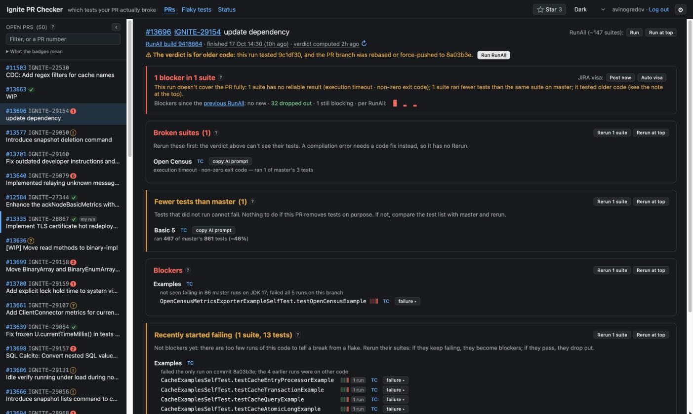

# Ignite PR Checker

[English](README.md) · **Русский**

Ignite PR Checker отвечает контрибьютору [Apache Ignite](https://github.com/apache/ignite) на один вопрос: какие
падения тестов в прогоне моего pull request вызвало моё изменение? Он читает TeamCity проекта, ci2, сравнивает каждое
падение с master и с другими PR и отфильтровывает то, что ими объясняется, с причиной для каждого. С той же страницы
можно запустить RunAll, перезапустить сьюты и отправить вердикт в тикет JIRA или в pull request.

Базы данных и общего аккаунта TeamCity нет. Каждый пользователь работает под своим токеном ci2, а состояние — это
несколько JSON-файлов на диске.

➡ **Живой инстанс: <https://ignite-pr-checker.is-a.dev>**. Вход со своим токеном доступа ci2.

➡ **[Тур по возможностям](docs/features.ru.md)**. Он начинается со [словаря вердикта](docs/features.ru.md#словарь-вердикта):
что значит каждая метка и что с ней делать.



## Что он делает

- **Вердикт.** Страница PR делит падения последнего RunAll этого PR на блокеры, тесты, которые недавно начали падать,
  битые сьюты и падения, которые не вменяются PR. Причина стоит под каждым тестом или один раз над тестами сьюты с
  общей причиной. См. [Прочитать вердикт](docs/features.ru.md#прочитать-вердикт).
- **Прогоны.** RunAll и перезапуск сьют — прямо со страницы, при спешке в начало очереди ci2. Строка прогонов
  показывает, что стоит в очереди и что идёт, с оценками времени; **Cancel my runs** останавливает твои. См.
  [Итерации над фиксом](docs/features.ru.md#итерации-над-фиксом).
- **Постоянные опции.** ⚙ группирует их по тому, что им нужно. Автоперезапуску упавших сьют и комментарию в PR на
  каждый твой прогон хватает входа в TeamCity. Визе в JIRA нужен токен JIRA, PR commands — привязанный аккаунт GitHub,
  а исправлению checkstyle и добавлению тестов в сьюты — токен GitHub для коммитов. Опции работают, пока страница
  закрыта. Когда чего-то не хватает, ⚙ и ответы в PR говорят, что сделать. См.
  [Постоянные опции](docs/features.ru.md#постоянные-опции).
- **Команды в PR.** Когда включены **PR commands** и аккаунт GitHub один раз привязан кнопкой **Link GitHub**,
  комментарий `/run-all` в любом pull request ставит RunAll под твоим аккаунтом TeamCity. Отвечает аккаунт GitHub
  самого чекера: его комментарий рассказывает, как идёт прогон, а новый упоминает тебя, когда вердикт готов. См.
  [Работа из PR](docs/features.ru.md#работа-из-pr-команды).
- **Доска флаки** на `/flaky.html`: тесты, которые падают на master, сначала флакующие, потом сломанные. См.
  [Доска флаки](docs/features.ru.md#доска-флаки-flakyhtml).
- **Страница статуса**: здоровье, память, прогрев, вызовы TeamCity, GitHub и JIRA, действующие настройки. Живая:
  <https://ignite-pr-checker.is-a.dev/status.html>.

## Как падение становится блокером

Каждый упавший тест оценивается в каждой сьюте отдельно. Один тест может идти в нескольких сьютах (тесты C++ идут на
Windows, Linux и Clang), и проход на одной платформе ничего не говорит о другой.

Упавший тест — **блокер**, когда выполняется всё это:

- **Ветка продолжает его ронять.** Он упал в каждом из своих последних 3 завершённых прогонов этой сьюты на ветке PR
  или во всех, если их было меньше: на первом RunAll этого PR хватает одного падения. Падение во всех прогонах текущего
  коммита PR, двух и больше, тоже считается. Каждый прогон сверяется с коммитом, который он собрал, так что проход на
  старом коде падение не снимает.
- **Master его не объясняет.** Он не падал в последних 100 прогонах этой сьюты на master на JDK этого PR. Падение на
  master делает тест pre-existing, если только оно не редкое и не давнее (не больше 2% прогонов, ни одного среди
  последних 10) и падений PR подряд слишком много для случайности, или master роняет его только при
  `TEST_SCALE_FACTOR`, с которым PR не запускался.
- **Другие PR его не объясняют.** Он не падает на ветках 3 и более других PR, если только падения PR подряд не
  перевешивают их частоту.

Тест, которого master и другие PR не объясняют, но который ветка роняет слишком редко для блокера, попадает в **Recently
started failing**, когда он упал в единственном прогоне свежезапушенного кода, а до этого проходил на ветке, или в двух
и больше последних прогонах того же кода после прохода на этом коде. Решит перезапуск. Всё остальное не вменяется PR и
показано со своей причиной. Сьюты без надёжного результата (ошибка компиляции, таймаут, падение JVM, упавший шаг сборки)
перечислены отдельно как битые. В [словаре](docs/features.ru.md#словарь-вердикта) есть все причины и пороги.

## Аккаунты и токены

- **Пользователи** входят со своим токеном доступа ci2. Он хранится зашифрованным (AES-GCM) в HttpOnly-cookie сессии, а
  прогоны, которые пользователь запускает или отменяет на странице, идут под его аккаунтом. Пока пользователь не вышел,
  сервер ещё держит его токен в памяти, но лишь около часа после последнего запроса. Этот токен сервер использует
  только для чтения из TeamCity, чтобы заранее разобрать открытые PR для всех. Любая постоянная опция, кроме одних PR
  commands, держит токен в памяти, пока включена. Если хост выгрузит память сервера в незашифрованный swap, токен
  окажется на диске в открытом виде. Вход действует, пока пользователь не выйдет (выход завершает его во всех
  браузерах) или не оставит его без дела на 400 дней.
- **Постоянные опции**, пока включены, хранят нужные им токены, зашифрованные `SESSION_SECRET`: токен TeamCity при
  любой опции, токен JIRA пользователя для виз и его токен GitHub для автоисправления checkstyle и добавления тестов в
  сьюты — двух опций, которые коммитят. Копии токенов остаются в бэкапах [каталога кэша](#каталог-кэша) 2 дня; в
  бэкапах старше 2 дней остаётся остальное состояние, без токенов.
- **Аккаунт GitHub.** PR commands исполняют комментарии того аккаунта GitHub, который пользователь привязал: кнопкой
  **Link GitHub** в ⚙ или токеном GitHub, хранимым для коммитов. **Link GitHub** идёт через OAuth App чекера, без
  scope. GitHub просит пользователя разрешить приложению видеть его публичный профиль и возвращает его с кодом. Чекер
  меняет код на токен, спрашивает GitHub, чей это аккаунт, и сразу отзывает токен; нигде его не хранит. Привязка
  засчитывается только в том входе, где её начали, в течение 10 минут и один раз. Чекер хранит логин и id аккаунта и
  считает комментарий командой, только если у его автора этот id. Аккаунт приложения привязать нельзя. **Unlink**
  забывает аккаунт: выключаются PR commands, а с ними опции, которые коммитят, и токен GitHub этого аккаунта.
- **Токен GitHub пользователя** только коммитит: коммит автоисправления и коммит, добавляющий тесты в сьюты, в ветку
  собственного PR пользователя. Комментариев, правок и реакций им не делается, а в `apache/ignite` он коммитит, только
  если PR сделан из ветки самого `apache/ignite`. Лучше всего fine-grained токен только на свой форк, с правом
  Contents: read and write. До PR из ветки самого `apache/ignite` или из чужого форка он не дотянется:
  для них нужен классический токен с `public_repo`, а он пушит во все публичные репозитории, куда может пушить
  пользователь, у коммиттера и в `apache/ignite`. Классический токен с `admin:*`, `delete_repo` или `workflow` чекер не
  берёт, с `repo` — берёт с предупреждением, и ни один не держит в cookie: страница отправляет его вместе с
  переключателем.
- **Срок жизни.** Токен JIRA действует со всеми правами аккаунта пользователя в JIRA (у ASF JIRA нет scope для
  токенов). Ему и токену GitHub стоит задать срок, например 90 дней. Когда токен истекает, опции, которые им
  пользуются, выключаются с пометкой в ⚙; когда пользователь вставит новый и снова включит их, визы, задержанные за это
  время, уходят — для прогонов, которые не вытеснил более новый RunAll.
- **Аккаунт приложения** — это аккаунт GitHub, которому принадлежит `GITHUB_TOKEN`. Под ним чекер читает GitHub, и от
  него идёт всё, что чекер пишет в PR, у всех пользователей одинаково: комментарии с вердиктом, которые упоминают
  запустившего прогон, рассказы о `/run-all`, реакции, ответы и отчёты о тестах, добавленных в сьюты. Правит и удаляет
  он только свои комментарии. Заведи для этого отдельный аккаунт без прав в `apache/*` и классический токен со scope
  `public_repo`: тогда утёкший токен не даст пушить в Apache Ignite. Задай токену срок, например 90 дней: копия
  бессрочного токена работает, пока его не отзовут. Когда GitHub велит его записям подождать
  (вторичный лимит), они уходят позже, как и записи сверх 40 в час в один PR или 60 за одного пользователя; страница
  статуса показывает записи, которые ждут или которые GitHub отклонил. Страница PR проверяет, тестирует ли идущая
  сборка head PR и сдвинулся ли head после прогона. Head PR, который вернул GitHub, чекер помнит 30 секунд.
  Пока у токена остаётся меньше пятой части часового лимита вызовов, эти проверки не обращаются к GitHub. Остаток
  нужен самому чекеру, например на PR commands, комментарии и визы. Без токена опции, которые пишут в GitHub,
  выключены. Чекер проверяет токен при старте и каждые 6 часов, а страница статуса показывает
  вошедшим, что нашлось: чей это токен, может ли он писать в репозиторий (fine-grained не может, классический без
  `public_repo` тоже), когда он истекает (предупреждение за 14 дней; бессрочный токен тоже даёт предупреждение) и
  может ли аккаунт пушить в репозиторий или в репозиторий самого чекера, откуда берутся его релизы. Чего GitHub не
  сказал, показано как неизвестное.

Общего аккаунта JIRA нет: виза уходит под токеном JIRA того пользователя, для которого она пишется.

## Быстрый старт

**Пользоваться.** Открой <https://ignite-pr-checker.is-a.dev> и войди с токеном доступа ci2 (TeamCity: Profile →
Access Tokens). Выбери PR слева или набери его номер в фильтре.

**Поднять свой инстанс** на Debian или Ubuntu, от root:

```bash
curl -fsSL https://raw.githubusercontent.com/anton-vinogradov/ignite-pr-checker/main/install.sh | sudo bash
```

Затем направь DNS-имя на хост, отдай сервис через HTTPS-прокси, пропиши `APP_PUBLIC_URL` в
`/etc/ignite-pr-checker/env` и перезапусти сервис; установщик печатает эти шаги. Привяжи сервис к loopback
(`SERVER_ADDRESS=127.0.0.1`, как в шаблоне env) и отдавай его только через прокси: пользователи вводят токены в его
форму входа. Минимальный `Caddyfile`, который заодно сжимает большие JSON-ответы:

```
{
	admin unix//run/caddy/admin.sock
}

prc.example.org {
	encode zstd gzip
	reverse_proxy 127.0.0.1:8080
}
```

Строка `admin` убирает admin API Caddy с порта 2019, к которому может подключиться любой локальный процесс. Тогда тот,
кто воспользуется уязвимостью в чекере, не сможет перенастроить прокси перед чекером. Эти команды добавляют к unit
Caddy drop-in systemd, и systemd создаёт каталог для сокета при старте Caddy:

```bash
sudo mkdir -p /etc/systemd/system/caddy.service.d
printf '[Service]\nRuntimeDirectory=caddy\n' | sudo tee /etc/systemd/system/caddy.service.d/admin-socket.conf
sudo systemctl daemon-reload && sudo systemctl restart caddy
```

Для **Link GitHub** в ⚙ нужно OAuth-приложение на GitHub (OAuth App). Зарегистрируй его под аккаунтом приложения: GitHub
→ Settings → Developer settings → OAuth Apps → New OAuth App. Application name — то, что пользователи увидят на GitHub,
например `Ignite PR Checker`. Homepage URL — `APP_PUBLIC_URL`. Authorization callback URL — `APP_PUBLIC_URL` с
`/api/github/callback` на конце, например `https://prc.example.org/api/github/callback`. Device Flow не включай. Затем
создай client secret, впиши client ID и секрет в `GITHUB_OAUTH_CLIENT_ID` и `GITHUB_OAUTH_CLIENT_SECRET` в файле env и
перезапусти сервис. Без них или с пустым `APP_PUBLIC_URL` в ⚙ нет **Link GitHub**, и аккаунт привязывает только токен
GitHub для коммитов.

**Разрабатывать** — с JDK 17:

```bash
./gradlew bootRun   # http://localhost:8080, профиль dev
./gradlew test
```

## Конфигурация

Настройки — переменные окружения в `/etc/ignite-pr-checker/env`; после изменения перезапусти сервис. Значения по
умолчанию рассчитаны на ci2 Apache Ignite. Каждый старт пишет в лог действующие настройки (`effective config: …`), а
страница статуса показывает их вошедшим. Значение вне допустимого диапазона заменяется значением по умолчанию, и
страница статуса об этом предупреждает. `install.sh` пишет файл env из шаблона один раз и больше его не трогает: на
существующей установке новые настройки добавляй руками.

| Переменная | По умолчанию | Зачем |
|---|---|---|
| `APP_PUBLIC_URL` | `https://ignite-pr-checker.is-a.dev`; в шаблоне env пусто | https-адрес, который открывают пользователи. Сюда ведут ссылки в комментариях PR, визах JIRA и ответах. Задай её на любом другом инстансе: пока она пуста, страница статуса предупреждает. |
| `SERVER_ADDRESS` | все интерфейсы; `127.0.0.1` в шаблоне env | Где слушает сервис. За HTTPS-прокси оставь `127.0.0.1`. |
| `SERVER_PORT` | `8080` | Порт. |
| `SESSION_SECRET` | случайный ключ на каждый старт; `install.sh` пишет постоянный | Шифрует cookie сессий и хранимые токены. Прежде чем менять, прочитай [Каталог кэша](#каталог-кэша). |
| `SESSION_COOKIE_SECURE` | `false`; `true` в шаблоне env | Отправлять cookie сессии только по HTTPS. `false` — только для тестовой установки на голом HTTP. |
| `GITHUB_TOKEN` | нет | Токен аккаунта приложения, от которого идёт каждый комментарий чекера: отдельного аккаунта GitHub без прав в `apache/*`, классический токен со scope `public_repo`. Без него GitHub отвечает сервису не больше чем на 60 вызовов в час, а писать чекеру не от кого: комментарий в PR, PR commands, автоисправление checkstyle и добавление тестов в сьюты выключены. |
| `GITHUB_OAUTH_CLIENT_ID`, `GITHUB_OAUTH_CLIENT_SECRET` | нет | Client ID и client secret OAuth App чекера на GitHub — для **Link GitHub** в ⚙. См. [Быстрый старт](#быстрый-старт). Без них пользователь привязывает аккаунт GitHub только токеном GitHub для коммитов. |
| `PRC_ADMINS` | нет | Имена операторов в TeamCity через запятую. См. [Операторы](#операторы). |
| `JAVA_OPTS` | нет | Дополнительные флаги JVM; `run.sh` ставит их после своих, например `-Xmx768m`. См. [Память](#память). |
| `TC_BASE_URL` | `https://ci2.ignite.apache.org/` | Какой TeamCity читать, со слешем в конце. |
| `TC_RUN_ALL_BUILD_TYPE` | `IgniteTests24Java8_RunAll` | Тип сборки цепочки RunAll. |
| `GITHUB_REPO` | `apache/ignite` | Чьи PR показываются и проверяются. |
| `JIRA_BASE_URL` | `https://issues.apache.org/jira` | Куда уходят визы и куда ведут ссылки на тикеты IGNITE. |
| `MASTER_HISTORY_DEPTH` | `100` | Сколько прогонов теста на master смотреть, на сьюту. |
| `BLOCKER_FAIL_STREAK` | `3` | Сколько упавших прогонов ветки подряд нужно для блокера. |
| `ANALYSIS_BASE_BRANCH` | `refs/heads/master` | Ветка, с которой сравниваются падения PR. |
| `ANALYSIS_CONCURRENCY` | `8` | Сколько вызовов TeamCity один разбор делает параллельно. |
| `ANALYSIS_CACHE_TTL_MINUTES` | `120` | Сколько живут в кэше история теста и вердикт. |
| `ANALYSIS_REFRESH_AFTER_SECONDS` | `120` | Просмотренный вердикт старше этого спрашивает TeamCity, не завершилось ли что-то на ветке, и если да, пересчитывается. |
| `WARM_ENABLED` | `true` | Держать новейшие открытые PR разобранными в фоне. |
| `WARM_COUNT` | `50` | Сколько PR. |
| `WARM_INTERVAL_MINUTES` | `10` | Как часто. |
| `WARM_TOKEN_TTL_MINUTES` | `60` | Сколько токен пользователя остаётся в пуле после его последнего запроса. |
| `AUTOMATION_ENABLED` | `true` | Разрешить постоянным опциям и PR commands действовать в фоне. |
| `PRC_PERSIST_ENABLED` | `true` | Хранить состояние и кэши на диске. |
| `PRC_CACHE_DIR` | `/opt/ignite-pr-checker/cache` | Где. |
| `PERSIST_INTERVAL_MINUTES` | `5` | Как часто пишутся кэши; состояние пишется в течение секунды после изменения. |
| `UPDATE_ENABLED` | `true` | Показывать кнопку **Update**. |
| `UPDATE_JAR_PATH` | `/opt/ignite-pr-checker/app.jar` | Работающий jar; запрос на обновление и `update-failed` лежат рядом с ним. |
| `PRC_LOG_FILE` | нет, только консоль; unit задаёт `/opt/ignite-pr-checker/logs/ignite-pr-checker.log` | Собственный лог сервиса: файл в день, 30 дней, не больше 500 МБ старых файлов. |
| `GITHUB_CACHE_SECONDS` | `300` | Сколько кэшируется список открытых PR. |
| `TEAMCITY_READ_TIMEOUT`, `GITHUB_READ_TIMEOUT`, `JIRA_READ_TIMEOUT` | `60s` | Сколько вызов может ждать без данных. |
| `GITHUB_API_URL` | `https://api.github.com` | Только для тестов. |
| `PRC_JAVA` | задаёт `install.sh` в unit | Какую java запускает `run.sh`. |

## Эксплуатация

### Установка и обновление

`install.sh`, та самая одна строка выше, ставит последний релиз или обновляет до него существующую установку.
Перезапускай его, чтобы получить новые версии скриптов и unit systemd, а не только jar. Он:

- берёт `java` из PATH, если это 17 или новее, а иначе ставит OpenJDK 17;
- создаёт сервисного пользователя `prc`. `/opt/ignite-pr-checker` с jar и скриптами принадлежит root, так что сервис
  не может изменить код, который выполняет; сам он пишет там только в `cache/`, `update/`, `dumps/` и `logs/`;
- пишет `/etc/ignite-pr-checker/env` из шаблона со сгенерированным `SESSION_SECRET`, если файла ещё нет;
- пишет `/etc/tmpfiles.d/ignite-pr-checker.conf`: пока сервис остановлен, systemd-tmpfiles при ежедневной чистке
  удаляет дамп кучи старше 2 дней;
- пишет `update.sh`, `run.sh` и unit `ignite-pr-checker`, ставит последний релиз через `update.sh`, запускает сервис
  и до 60 с ждёт, пока он ответит.

**Обновление со страницы.** Когда выходит новый релиз, в шапке появляется **Update to vX.Y.Z** и ссылка **what's new**
на заметки к релизу или, если это не следующий патч-релиз, на список релизов. Кнопка перезапускает сервис. Перед
стартом systemd запускает `update.sh` от root, и тот:

- скачивает ровно тот релиз, который предложила кнопка;
- ставит его, только если он новее работающего релиза: тогда через уязвимость в сервисе никто не откатит сервис на
  старый релиз. `update.sh` узнаёт работающий релиз по sha256 его jar. При установке `update.sh` и `deploy.sh`
  записывают в `installed-jars` sha256 jar и номер его релиза. Если jar скопирован руками, обновление со страницы
  завершится ошибкой;
- ставит его, только если sha256 совпадает с хэшем, который GitHub указывает для `ignite-pr-checker.jar` этого релиза;
- сохраняет заменённый jar как `app.jar.prev`, если это не тот же самый jar;
- при сбое оставляет текущий jar и пишет причину в `/opt/ignite-pr-checker/update-failed`. Тогда кнопка называется
  **Retry update to vX.Y.Z**, а причина — в её подсказке. Сервис стартует в любом случае.

**Поставить конкретную версию.** `install.sh` всегда берёт последний релиз; `update.sh` ставит названный, в том
числе более старый:

```bash
sudo /opt/ignite-pr-checker/update.sh 1.23.1 && sudo systemctl restart ignite-pr-checker
```

**Откатиться** на jar, который работал до последнего обновления, установки или выкладки:

```bash
cd /opt/ignite-pr-checker && sudo install -m 644 app.jar.prev app.jar && sudo systemctl restart ignite-pr-checker
```

Именно `install`, не `cp`: `cp` пишет в тот jar, который ещё читает работающий сервис, и тот при остановке не может
сохранить своё состояние. Jar, поставленного до v1.35.0, нет в `installed-jars`, поэтому после отката на него
обновление со страницы завершится ошибкой. Следующий релиз ставь через `update.sh`, как показано выше.

Первый старт новой сборки копирует каждый файл состояния в `<file>.before-<version>-built-<time>`. Чтобы отменить то,
что записал плохой релиз, останови сервис, скопируй этот файл поверх файла состояния и запусти старый jar. В копии
старше 2 дней токенов нет. Jar версии v1.37.0 или более ранней, запущенный на такой копии, выключает визу и опции,
которые коммитят, как будто JIRA или GitHub отвергли токен. Каждый пользователь включает их снова со своим токеном.

### Сервис и логи

```bash
sudo systemctl status ignite-pr-checker
sudo systemctl restart ignite-pr-checker   # после изменения /etc/ignite-pr-checker/env
journalctl -u ignite-pr-checker -f
sudo tail -f /opt/ignite-pr-checker/logs/ignite-pr-checker.log
```

Собственный лог сервиса хранит 30 дней, файл в день. Страница статуса помнит недавние предупреждения и ошибки после
перезапусков, их читают [операторы](#операторы). Сверху она перечисляет, что не так сейчас: остановившуюся фоновую
задачу, нечитаемый файл состояния, настройку вне диапазона.

Логгеры ниже на DEBUG и TRACE пишут токены, поэтому `application.yml` держит их на INFO, какой бы уровень ни задал
файл env для их пакета или для root:

- логгеры Spring — текст тела запроса, которое сервис не смог прочитать, и аргументы обработчика запроса;
- логгеры httpclient — заголовки вызовов GitHub;
- `HttpURLConnection` из JDK — заголовки вызовов TeamCity и JIRA;
- логгеры Tomcat — каждый входящий запрос и cookie сессии.

### Память

JVM получает `-Xmx512m`. Когда памяти не хватает, JVM пишет дамп кучи в `/opt/ignite-pr-checker/dumps/` и завершается, а
systemd запускает её снова; `run.sh` оставляет только самый свежий дамп. В дампе расшифрованные токены и ключ,
полученный из `SESSION_SECRET`, поэтому читать этот каталог может только сервис. Сервис удаляет дамп через 2 дня после
того, как JVM его записала. Пока сервис остановлен, дамп удаляет systemd-tmpfiles: при первой ежедневной чистке после
того, как дампу исполнится 2 дня. Это правило понимает systemd 249 и новее, как в Ubuntu 22.04; более старый systemd его
отвергает. Пока дамп не удалён, страница статуса показывает карточку **Out of memory**: когда JVM не хватило памяти и
когда дамп удалится. Чтобы дать больше кучи, пропиши `JAVA_OPTS=-Xmx768m` в файле env и перезапусти. Страница статуса
показывает кучу с пиком её старого поколения и резидентную память процесса с её пиком.

В памяти JVM тоже лежат расшифрованные токены, и хост может выгрузить её в swap. Шифруй swap случайным ключом при
каждой загрузке, иначе токены могут остаться в swap-файле.

### Каталог кэша

`/opt/ignite-pr-checker/cache` (`PRC_CACHE_DIR`) принадлежит `prc`, права 700:

| Файл | Что в нём |
|---|---|
| `standing-visas.json` | Постоянные опции каждого пользователя, его хранимые токены TeamCity, JIRA и GitHub (зашифрованы; от токена TeamCity, который TeamCity отверг, — только SHA-256, чтобы узнать его снова), логины и id аккаунтов GitHub, комментарии и визы, за которыми следят опции, визы и комментарии, задержанные отвергнутым токеном, волны перезапусков. |
| `visa-subs.json` | Взведённые разовые Auto visa, у каждой свой токен JIRA (зашифрован), и те, чей токен JIRA отвергла, — без него. |
| `pr-commands.json` | Опрос PR-команд: обработанные комментарии, рассказы о прогонах, кто получил ответ-знакомство, реакции и ответы, которые GitHub ещё не принял. |
| `suite-fixes.json` | Добавление тестов PR в сьюты: каждый head-коммит, за который уже брались (один раз), запушенный коммит и комментарий с отчётом. |
| `reruns.json` | Сборки в очереди и в работе, за которыми следят страница и опции. |
| `admin-actions.json` | Последние перезапуск, обновление и сброс кэшей: кто и когда. |
| `problems.json` | Недавние предупреждения и ошибки для страницы статуса. |
| `users.json` | Кто и когда пользовался сервисом и когда каждый последний раз выходил: cookie сессий, выданные до выхода, остаются отвергнутыми. Только имена, без токенов. |
| `analysis.json`, `flaky.json`, `suite-baseline.json`, `delta.json`, `github.json`, `metrics.json` | Кэши: вердикты и ответы TeamCity, доска флаки, число тестов сьют на master, разница между прогонами, открытые PR, счётчики страницы статуса. Без них сервис стартует медленнее. |
| `merged/<pr>.json` | Вердикт смерженного PR таким, каким он был в момент мержа. Пишется один раз, не удаляется. |
| `backups/cache-YYYY-MM-DD.zip` | Все файлы снапшотов, раз в день в zip, хранятся 7 последних. `merged/` в них нет. |
| `<file>.bad-<time>` | Файл, который не удалось прочитать при старте, отложен в сторону; эта часть стартовала пустой. |
| `<file>.before-<version>-built-<time>` | Файл, каким он был до первого запуска новой сборки; хранятся 5 последних на файл. |

Состояние пишется в течение секунды после изменения, кэши — раз в 5 минут, а всё вместе — при остановке.

Бэкапы и файлы `.before-` и `.bad-` хранят токены 2 дня с того момента, как сделана копия. Потом сервис вынимает из них
токены и оставляет остальное; такие копии он ищет раз в 10 минут. В состоянии, восстановленном из такой копии, опции
каждого пользователя остаются включёнными, но стоят на паузе, пока он не вернёт недостающие токены. Токен TeamCity
возвращается, когда пользователь открывает чекер или входит снова. ⚙ просит сохранить заново токен JIRA и токен GitHub
для коммитов. Файл `.bad-`, который не JSON, сохраняет токены: лог называет его, так что удали его, когда он станет не
нужен.

Токены в этих файлах, включая бэкапы, зашифрованы `SESSION_SECRET`. Смена секрета разлогинивает всех и делает
хранимые токены нечитаемыми. Взведённые Auto visa пропадают. Постоянные опции владельца не ждут: когда заканчивается
прогон пользователя с включённым автоперезапуском, автовизой или комментарием в PR, чекер сбрасывает все его опции
вместе с привязанным логином GitHub, если не может прочитать его токен TeamCity или токен JIRA при включённой
автовизе. Свежий токен TeamCity пользователь сохраняет, когда входит снова, а свежий токен JIRA или GitHub — когда
выключает и снова включает автовизу, автоисправление или добавление тестов в сьюты с новым токеном. Меняй секрет, только если он утёк, и попроси пользователей сделать и то и другое до
конца их следующего прогона.

### Если утёк секрет

Действуй при любом признаке, что кто-то мог прочитать секреты сервиса: чужой на хосте, копия файла env, дамп кучи или
swap-файл в чужих руках. У кого есть `SESSION_SECRET`, тот расшифрует все хранимые токены, в бэкапах тоже, и соберёт
cookie сессии любого пользователя.

1. Замени в файле env `SESSION_SECRET`, `GITHUB_TOKEN` и `GITHUB_OAUTH_CLIENT_SECRET` и перезапусти сервис один раз.
   Отзови на GitHub старый токен приложения и старый client secret. Перезапусти и Caddy: тогда он снова работает по
   `Caddyfile`, а не по настройке, которую кто-то залил через его admin API.
2. Попроси каждого пользователя из `users.json` выпустить новые токены TeamCity, JIRA и GitHub и отозвать старые в
   ci2, JIRA и GitHub. Смена секрета завершает вход у всех; что она делает с хранимыми токенами, сказано в разделе
   [Каталог кэша](#каталог-кэша).
3. По желанию удали копии состояния, время изменения которых попадает в последние 2 дня: файлы в
   `cache/backups/`, `*.before-*` и `*.bad-*`. В них старые токены, зашифрованные старым `SESSION_SECRET`. Удали и
   каждую копию, которую лог называет после «could not take the tokens out of»: в ней ещё могут быть токены. В
   остальных более старых копиях токенов нет, и к ним состояние по-прежнему можно откатить.

### Операторы

Операторы — пользователи TeamCity, которых через запятую называет `PRC_ADMINS`. Только они видят на странице статуса
сообщения лога, кто последним перезапускал и сбрасывал кэши, и список на вкладке **Users**. Только они могут нажать
**Restart service**, **Update** и **Flush caches**. Это проверяет сам сервер: другим он этого не отдаёт и их нажатия
отклоняет. Страница PR показывает **operator** рядом с именем оператора. Остальные вошедшие видят, сколько записано
предупреждений и ошибок, но не сами сообщения. Каждое нажатие пишется в лог с именем оператора.

Без `PRC_ADMINS` операторов нет. Никто не может перезапустить, обновить или сбросить сервис со страниц, и никто не
видит сообщений лога на странице статуса: они остаются в журнале и в собственном логе сервиса. Чтобы назначить
операторов, задай `PRC_ADMINS` в `/etc/ignite-pr-checker/env`: их имена в TeamCity через запятую. Потом перезапусти
сервис.

### Релизы

Релиз собирает CI по тегу:

```bash
git tag v1.24.0 && git push origin v1.24.0
```

Workflow релиза прогоняет все тесты и публикует jar как `ignite-pr-checker.jar`. Заметки к релизу собираются из
раздела **What changes for users** каждого PR, смерженного после предыдущего тега, с предупреждением, если изменился
`TestVerdict.RULES`: тогда после обновления все вердикты считаются заново.

Мейнтейнеру: заполняй **What changes for users** в каждом PR (он есть в шаблоне), выпускай смену правил вердикта
минорной версией и собирай мелкие PR в один релиз.

### Выкладка локальной сборки

`deploy.sh` собирает и тестирует jar на твоей машине, копирует его по SSH (`PRC_SSH_HOST`, по умолчанию `ignite-prc`)
и перезапускает сервис. Он отказывается работать, если в том, что попадает в jar, есть незакоммиченные изменения
(`--force` выкладывает сборку с версией `…-dirty`). Заменённый jar он сохраняет как `app.jar.prev`, только если тот
отвечал, до 60 с ждёт новую версию и печатает команду отката, если она не поднялась.

## Архитектура

Одно приложение Spring Boot; пакеты внутри `com.github.igniteprchecker`:

| Пакет | Что делает |
|---|---|
| `tc` | Клиент TeamCity REST и `RerunTracker`, который следит за сборками в очереди и в работе. Действия пользователя идут под его собственным токеном; фоновое чтение берёт токены других пользователей и только читает ими. |
| `analysis` | Вердикт: `ChainCollector` обходит цепочку RunAll, `BlockerAnalyzer` оценивает каждое падение, плюс оговорки, корневые причины, доска флаки, вердикты смерженных PR и прогрев с пулом токенов. |
| `jira` | Тексты вердикта (`VisaService`), постоянные опции, которые доводят прогоны перезапусками, комментариями и визами (`StandingVisas`), и разовые Auto visa. |
| `github` | Клиент GitHub (список PR, комментарии, реакции, коммиты) и опрос PR-команд (`PrCommands`). |
| `style` | Автоисправление checkstyle в собственном PR автора. |
| `web` | HTTP API, вход, действия оператора, заголовки безопасности. |
| `persist` | Снапшоты состояния и кэшей на диске и их бэкапы. |
| `health`, `metrics` | Страница статуса: недавние проблемы, здоровье фоновых задач, счётчики вызовов, память. |
| `update` | Обновление из приложения, которое просит `update.sh` поставить релиз. |
| `config`, `session` | Настройки и зашифрованная cookie сессии. |

Страницы — статические файлы `index.html`, `flaky.html` и `status.html`, их код — в `static/*.js`, а общие помощники —
в `static/common.js`.

## Разработка

- `./gradlew bootRun` работает с профилем `dev`: слушает `127.0.0.1:8080`, держит состояние в `./build/prc-cache` и
  не прогревает PR, не действует на PR в фоне и не обновляется сам. Открытый PR всё равно разбирается на ci2 под твоим
  токеном. Попробовать прогрев: `WARM_ENABLED=true WARM_COUNT=3 ./gradlew bootRun`.
- `./gradlew test` прогоняет тесты, включая скрипты страниц под node (без node они пропускаются), и пишет отчёт о
  покрытии в `build/reports/jacoco/test/html`. CI запускает `./gradlew build` и `node --check` на каждом скрипте
  страниц.
- Документация идёт парами, на английском и на русском. Меняй обе: `DocParityTest` сверяет их по разделам: число
  абзацев, пунктов списков и строк таблиц, числа, код в кавычках и жирные названия, которые русский текст оставляет
  по-английски. Что говорят сами предложения, он не читает.

## Лицензия

Apache License 2.0, см. [LICENSE](LICENSE).
