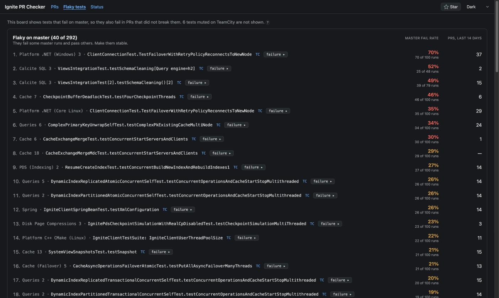
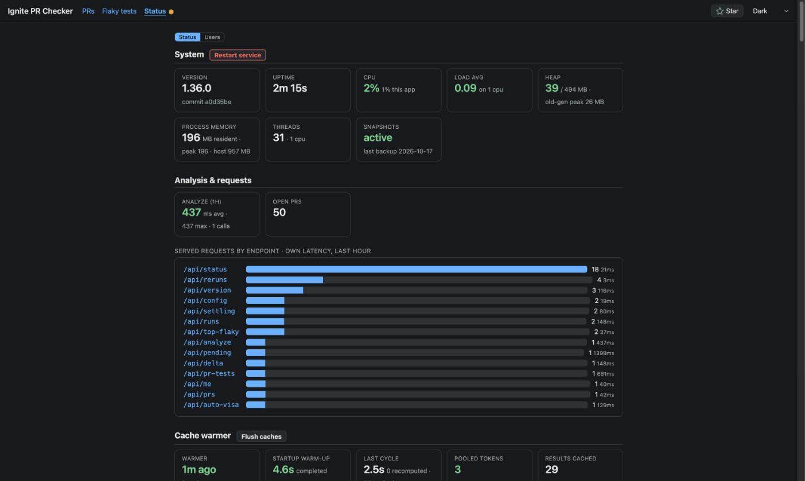

# Feature tour

**English** · [Русский](features.ru.md)

What Ignite PR Checker can do, screen by screen. The screenshots are of the production instance in the Dark theme; the
selector in the top bar has four themes: Light, Dark, JetBrains and Terminal.

## Verdict glossary

Every label the checker puts on a PR, a suite or a test: what it means and what to do. The **?** marks on the
page, the PR comment and the JIRA visa link here. The numbers are the defaults in the code; see
[Thresholds](#thresholds).

### Cards on the PR page

| Card or heading | What it means | What to do |
|---|---|---|
| **Blockers** | Tests this PR most likely broke: they fail in its runs, and neither master nor other PRs explain them. Each suite is judged on its own. The line under a test says why ([reasons](#reasons-under-a-test)). When tests of a suite have the same reason, the line stands once above them. | Open **failure ▸** or **TC**, fix the code, push, run RunAll again. |
| **Not confirmed: 1 run** | Blockers that failed the only time they ran on this branch. They still count as blockers: in the count, the PR list badge, the visa and the comment. The heading says that each of these tests failed its only run on this branch. So their rows leave out `failed the only run on this branch`, the `1 run` tag and a strip of one bar. If every blocker failed its only run on this branch, the line **Not confirmed yet** above the Blockers list says so, and this group is not shown. | **Rerun** their suites. A second failure confirms the blocker, a pass drops it. |
| **Recently started failing** | Tests failing on the code this run tested, with too few runs of it to tell a break from a flake. Not blockers yet. | **Rerun** the suite. If it keeps failing, it becomes a blocker; if it passes, it drops out. |
| **Could not be checked** | Failed tests that TeamCity errors kept from being compared with master and the branch. Not counted as blockers. | Nothing: the checker tries them again on its own. |
| **Broken suites** | Suites with no reliable result ([causes](#broken-suite-causes)). A timed-out or crashed suite is listed here, and the checker does not look for blockers in it. Its failures would come from the timeout or crash, and some tests never ran. | Re-run them first: the verdict can't see their tests. A suite that failed to compile has no **Rerun**: it needs a code fix. |
| **Fewer tests than master** | Suites that ran at least 10% fewer tests than the same suite on master; only suites with 20 or more tests on master are compared. Tests that never ran can't fail. | If the PR removes tests on purpose, nothing. Otherwise compare the test list with master and re-run. |
| **Crashed near the end of the run** | Suites that hit a timeout, out-of-memory error or JVM crash after running over 90% of master's tests, with no failure blamed on the PR. Their results stand. Shown folded, with the count in its heading. | Nothing for the PR. |
| **⚠ Suites that never ran** | The RunAll was interrupted: these suites were cancelled and never ran. The verdict says nothing about them. Suites a person cancelled are folded into one line per person. | **Rerun** them, or run RunAll again. |
| **This PR's tests** | How the test classes the PR adds (`new`) or changes (`changed`) ran in this RunAll. Each class lists its tests that failed or ran longer than 60 s. The **all N tests** button opens every test of the class with its status and time. A test's name opens its run in TeamCity; a suite's name opens the suite's run. The line under a failed test says what the verdict did with it: `blocks this PR`, `recently started failing: …`, `could not be checked` or `not blamed: …`. Each links to the test's row in the matching card: **Blockers**, **Recently started failing**, **Could not be checked** or **Not blamed on this PR**. The verdict does not judge a test of a suite that timed out or crashed (`not checked: its suite broke`). It also does not judge a failure that TeamCity muted (`not checked: TeamCity muted it`). A failure the verdict has not judged reads `not checked yet` while the verdict can still change: a RunAll is still going, or the checker tries again after TeamCity errors. In a final verdict, it reads `not checked`. The class line counts what the verdict did with its failures, for example `3 failed (none blamed on this PR)`. A class that Ignite's own abandoned-tests check finds in no test suite is tagged `not in any suite`. A class with no runs says why, when Ignite's abandoned-tests check and the files changed since the run show the reason: a commit after the run added it or put it in a suite, its suite did not run or broke, or it is a base or `@Ignore` class. When they show no reason, a note above the list names the possible reasons once for all such classes. The abandoned-tests check may still be running or be waiting for a maintainer to approve its run (a push by someone outside the project). It may also be skipped, or its result can't be read. Then a note above the list says so and how many classes did not run, if any. The card does not say why these classes did not run: without the check, nobody can tell. | Check that the new tests ran and passed. Fix a failed test that `blocks this PR`. Add a `not in any suite` class to a test suite or mark it `@Ignore`. |
| **Not blamed on this PR** | Failures not blamed on the PR, each with its reason: they fail on master too, are flaky, or passed in a later run. Shown folded. | Nothing for this PR. Re-run only to double-check the flaky ones. Tests that fail on master are on the flaky board (`/flaky.html`). |
| **✓ No blockers** | The run covered the PR's current code and blamed nothing on it. The PR list shows **✓**. | You can merge the PR. |
| **No proven blockers yet** | No test was blamed, but tests started failing on the code this run tested: they are under **Recently started failing**. The PR list shows **!**. | **Rerun** their suites: a re-run shows whether these tests are blockers. |
| **No blockers found — not proven clean** | No test was blamed, but the verdict can't call the PR clean. The amber lines under the heading say why ([caveats](#caveats)). The PR list shows **?**. While the page still checks that the run tested the PR's latest commit, the heading reads **No blockers found**. | Handle what the lines list, then re-run. |

### Reasons under a test

A reason has a master part and a branch part, joined by `;`. `N`, `F/R` and `abc1234` stand for numbers and a
commit. `on JDK 17` means only master runs on the PR's JDK were counted. A muted failure is never listed, and a
run where the test was ignored does not count as a run.

| Reason | What it means | What to do |
|---|---|---|
| `not seen failing in N master runs` | Master ran the test N times in this suite (its last 100 runs at most) and it never failed. | Read the branch part. |
| `not seen failing in only N master runs on JDK 17` | The same, with fewer than 10 master runs on the PR's JDK: thin evidence. | Read the branch part. |
| `no master history (can't prove pre-existing)` | Master has no run of the test on the PR's JDK: a new test, or one master does not run. Tagged `new test / no master history`. | Make sure the test is stable: this PR is all there is to judge it by. |
| `rare on master: fails F/R, passed the last G` | Master fails the test in at most 2% of its runs, none of the newest 10, and the PR's failures in a row are too many to be that chance. | Treat it as a blocker. |
| `fails F/R on master at TEST_SCALE_FACTOR=1.0, but f/r on other PR branches at 0.1` | Master fails the test in at least half its runs, but only at a scale factor this PR did not run at. Other PRs, run like this one, seldom fail it, and this PR's failures in a row are too many for their rate. | Treat it as a blocker. |
| `…; fails F/R in K other PRs` (on a blocker) | It fails in 3 or more other PRs too, but this PR's failures in a row are too many to be that flakiness. | Treat it as a blocker. |
| `failed all N runs on this branch`, `failed the last N of M runs on this branch` | The last 3 finished runs of the suite on the branch failed the test, or all of them when there were fewer. A blocker. | Fix the code. |
| `failed the only run on this branch` | The test ran once on the branch and failed. A blocker that is not confirmed yet. The line under the test leaves this part out, because **Not confirmed: 1 run** or **Not confirmed yet** above the test already says so. | **Rerun** the suite to confirm it. |
| `failed all N runs on commit abc1234` | Every run of the PR's current code failed the test, and there were at least 2. A blocker. | Fix the code. |
| `failed the only run on commit abc1234; the N earlier runs were on other code` | The current code ran once and failed; the earlier runs were on older code. Listed under **Recently started failing**. | **Rerun** the suite. |
| `failed the latest run; TeamCity gave no commit for it, so the N earlier runs do not count` | The latest run failed, and TeamCity gave no commit for it. The earlier runs may have tested other code, so only the latest run counts. Listed under **Recently started failing**. | **Rerun** the suite. |
| `failed the last N of M runs on commit abc1234, after a pass on the same commit` | At least 2 failures in a row on the current code, after a pass on the same code. Listed under **Recently started failing**. | **Rerun** the suite. |
| `…; too few failures on this code yet to outweigh other PRs` | The scale factor case above, without enough failures yet to beat the other PRs' rate. Listed under **Recently started failing**. | **Rerun** the suite. |
| `pre-existing: fails F/R on master` | Master fails the test too. Listed under **Not blamed on this PR**. | Nothing for the PR. |
| `flaky on other PR branches: fails F/R in K other PRs; …` | It fails in 3 or more other PRs, and this PR's failures are not enough to outweigh that. Listed under **Not blamed on this PR**. | Nothing for the PR. |
| `flaky on branch: failed only the latest of N runs on commit abc1234 (an earlier run on the same code passed)` | It failed once after passing on the same code. Listed under **Not blamed on this PR**. | Nothing, or re-run to be sure. |
| `not failing in the last finished run (passed on re-run)` | The newest finished run of the test on the branch passed. Listed under **Not blamed on this PR**. | Nothing. |
| `could not verify (TeamCity error: …)` | A TeamCity error stopped the check. Listed under **Could not be checked**. | Nothing: it is tried again. |
| `the N earlier runs were on other code` | Runs on an older commit don't count; they are dimmed in the strip. | — |
| `passed just before, but TeamCity gave no commits to prove that was the same code`, `after a pass; TeamCity gave no commits to prove that was the same code` | TeamCity gave no commit for any run of the test on the branch, so the pass may have been on other code. | — |
| `revision`, `run(s)`, `— watch` in a merged PR's verdict | A merged PR keeps the verdict it had at the merge, in the words of the checker release that computed it. | — |

### Caveats

The amber lines under the verdict heading, and the list under "This run doesn't cover the PR fully" in the comment
and the visa.

| Caveat | What it means | What to do |
|---|---|---|
| `Build failed — N suites that need it did not run` | A run the other suites need failed, so they never ran. | Fix the build, push, run RunAll again. |
| `the RunAll was interrupted — N suites never ran` | Suites were cancelled before they ran. | **Rerun** them, or run RunAll again. |
| `N suites have no reliable result (…)` | Broken suites; their causes are in brackets. | See [broken suite causes](#broken-suite-causes). |
| `N suites ran fewer tests than the same suites on master` | See **Fewer tests than master**. | Check the test lists, re-run. |
| `N failed tests could not be checked (TeamCity errors)` | See **Could not be checked**. The visa, the PR comment and the auto re-run wait up to 20 minutes for a retry; then they go ahead and list those tests apart. | Wait. |
| `a newer run is still going — its unfinished suites can still fail` | The verdict folds in a RunAll that is still running. | Wait for it to finish. |
| `N commits pushed since this run — it tested older code`, `new commits pushed since this run — it tested older code` | The PR's head has moved since the run. The comment and the visa use these words; the page says `it tested older code (see the note at the top)`, and the line at the top names both commits, with their count once GitHub answers. | Run RunAll again. |
| `could not check whether the PR changed since this run` | On the page only: GitHub or ci2 did not say whether the PR's head is still the commit the run tested, so the page does not call the verdict clean. The same can happen while fewer than a fifth of the checker's hourly GitHub calls are left: the page then does not ask GitHub about it. | Reload the page in a minute. If the **GitHub API** card on the status page shows fewer than a fifth of the calls left, wait until GitHub resets the hourly limit. |

### Broken suite causes

| Cause | What it means | What to do |
|---|---|---|
| `compilation error` | The suite's code did not compile. The page offers no **Rerun** for it: the same code fails the same way. | Fix the build, push, run RunAll again. |
| `execution timeout` | The suite ran out of time. Its failures are likely hang cascade, and some tests never ran. | Re-run. If it times out again, look at the thread dump in TeamCity. |
| `JVM crash / out of memory` | The JVM died mid-run. | Re-run. If it repeats, look for the crash or the leak in the build log. |
| `non-zero exit code` | The build exited with an error, and no unmuted test failed. | Open **TC** to see what failed. |
| `failed dependency` | A run this suite depends on failed. | Fix that run first. |
| `failed without running tests` | TeamCity named no problem, and no test failed. | Open **TC**, re-run. |
| `ci2 glitch: artifacts unavailable (N suites)` | ci2 could not hand these suites the artifacts of a run they need, though that run passed. | Re-run them: a new run usually gets them. |
| `Build failed — N suites that need it did not run; fix the build, then /run-all` | The build step failed, and the suites that need it never ran. `nothing else ran` when that was the whole chain. | Fix the build, push, `/run-all` or **Run**. |
| `Build failed in this run and passed on a re-run since — N suites that need it never ran; /run-all to run them` | The build passes now, but the suites that need it have no result. | `/run-all` or **Run**. |
| `— ran 33 of master's 67 tests` (after a cause), `ran 33 of master's 67 tests` (alone), `ran fewer tests than on master` (a group) | How far the broken suite got. The cause explains the shortfall; it is not a missing-tests finding of its own. When TeamCity reported nothing but its own count of this shortfall, the line says only how far the suite got. Several such suites with different counts share the line `ran fewer tests than on master`, and each suite keeps its own count. When TeamCity's count has other numbers, the line keeps it: TeamCity compared with a run it chose itself. | — |
| anything else | The first line of TeamCity's own problem text. | Open **TC**. |

### Tags next to a test

| Tag | What it means | What to do |
|---|---|---|
| strip of bars | The finished runs of the test in its suite on the branch, oldest to newest: red failed, green passed. Dimmed bars ran on older code; the bright ones ran on the code of the newest run. Under **Not confirmed: 1 run** and **Not confirmed yet**, the page leaves out a strip of one bar: these already say that each test there failed its only run on this branch. | — |
| `flaky?` | The test failed and then passed on the same code. | Look for a race or a timing problem. |
| `1 run` | The test ran once on this code and failed. The tag is not shown under **Not confirmed: 1 run** and **Not confirmed yet**. Both say that each test there failed its only run on this branch. | **Rerun** the suite: it confirms or clears it. |
| `new test / no master history` | Master has no runs of the test on this JDK to compare with: a new test, or one master does not run. | Make sure the test is stable. |
| `not in any suite` (on a test class) | Ignite's own check (GitHub Actions job Check java code, step "Run abandoned tests checks.") finds the class in no test suite, so CI never runs it. Shown in **This PR's tests**; the PR comment and the visa say it too, and the verdict stays as it is. | Add it to a test suite or mark it `@Ignore`, or switch on **Add my PR's tests that no suite runs** in ⚙. |
| `unverified` | A TeamCity error kept part of the check from being made: other PRs' runs of the test. The checker tries again. | Wait. |
| `⚖ assertion — likely a real logic failure` (in **failure ▸**) | A failed check. | Fix the code. |
| `environment/timing — a re-run may pass` | Environment or timing trouble. | Re-run. |
| `environment/timing — but it failed all N runs of this code, …` | The same, but every run of this code failed. | A re-run alone is unlikely to pass: fix it. |
| `⌛ hang — the test ran out of time; …` | The test hung. The test's thread from the thread dump is shown. | See where that thread waits. |
| **failure ▸** / **copy failure** / **copy AI prompt** | **failure ▸** opens a panel with the failure message and the stack trace. In the panel, **copy failure** copies the message and **copy AI prompt** copies a fix prompt for a coding assistant. If there is no failure message to open, **copy AI prompt** is on the row itself. | — |

### Badges in the PR list

| Badge | What it means | What to do |
|---|---|---|
| red number | Blockers in the PR's latest analysed RunAll. | Open the PR. |
| **!** | No blockers yet, but tests started failing on the code the run tested. | A re-run shows whether these tests are blockers. |
| **?** | No blockers found, but the PR is not proven clean, for one or more of these reasons. The run can't prove it ([caveats](#caveats)): it was interrupted, suites broke or ran fewer tests than on master, failed tests could not be checked, or a newer run is still going. Commits were pushed after the run. It is not known whether the run tested the PR's latest commit. | Open the PR for the reason. |
| **✓** | A clean run of the PR's current code. | — |
| **…** | Only for the PR open on the page: no blockers found, and the page is checking that the run tested the PR's latest commit. Once it knows, the badge turns into **✓** or **?**. | Wait. |
| none | No verdict yet. | Open the PR to analyse it. |
| **my run** | You started its latest RunAll. The PR may be someone else's. | — |

### Runs, buttons and visas

| Label | What it means | What to do |
|---|---|---|
| `queued`, `running` | A build of this PR on ci2 now, under **On ci2 now**. The time next to it is how long it has waited or run so far; `~14m left` and `starts ~5m` are estimates from the queue and the suite's progress. | — |
| `on latest commit` | The run tests the PR's latest commit. | — |
| `⚠ old commit abc1234` | Commits were pushed after the run started: it tests older code. | Run RunAll again when it matters. |
| `takes latest commit at start` | The run is still queued; TeamCity picks the PR's latest commit when it starts. | — |
| `by alice` | Someone else started this run. **Cancel my runs** leaves it alone. | — |
| `● includes an unfinished run` | The verdict folds in the finished suites of a RunAll that is still running. It never reads green. | Wait for the run. |
| `6 suites ran, 141 reused from earlier runs` | How many suites of the chain ran, and how many TeamCity reused from earlier runs of the same commit. Shown when some were reused, or while the run still goes. | — |
| `Blockers since the previous RunAll: 2 new · 3 dropped out · 5 still blocking` | Blockers compared with the PR's previous RunAll, suite by suite. `dropped out`: no longer a blocker, because it passed, moved to another list or did not run. Zero new reads `no new`. A zero `dropped out` or `still blocking` is left out. With all three zero, there is no line. From three RunAlls on, a bar per run stands beside it. | — |
| `⚠ The verdict is for older code` | The run tested an older commit than the PR's head; the line names both commits. While a new RunAll is queued or running, it says so instead of offering the button. On a merged PR the line only names the commit the run tested and the commit the PR was merged at, with no button. | **Run RunAll**. |
| `♻︎ Auto re-run #1 of up to 2`, `♻︎ Deciding whether to re-run the failed suites` | Auto re-runs are still settling this run: the verdict may change. | Wait. **🔔 Notify me** tells you when it is final. |
| **Run**, **Run at top** | Queue a new RunAll chain for the PR, at the end or at the top of the ci2 queue. Always asks first. | — |
| **Rerun**, **Rerun at top** | Re-run a suite, or every suite of a section: the section's button says how many suites, and a suite row has its own pair of small text buttons. A pair that would re-run the same suites as the pair above it is left out. One button is filled as the next step: **Run RunAll** for older code, else the broken or never-ran suites, else the blockers on one run. On a merged PR no button is filled. Five or more suites ask first. A line under the buttons says why, when the suites are not queued or are queued at the end, not at the top. | — |
| **Cancel my runs** | Cancels the builds you started on this PR. | — |
| `Visa: posted to IGNITE-12345` | The visa of this run is in the ticket. The key links to the comment. | — |
| `Visa: will be posted to IGNITE-12345 when the run settles` | You started the run, and your **Visa my runs in JIRA** is on. The visa goes out once the run and its auto re-runs settle. | Wait. |
| `Visa: JIRA did not take it, the checker tries again every 10 minutes` | You started the run. It settled, but JIRA did not take the visa. The checker keeps trying while Visa my runs in JIRA stays on and no newer RunAll replaces the run. | Wait. |
| `Visa: bob, who started this run, has Visa my runs in JIRA on` | Only the option of whoever started a run posts its visa, and bob's is on. The line says nothing more about another person's option. | — |
| `Visa: Visa my runs in JIRA is off in ⚙` | You started this run, and your option is off. When the line ends with `because JIRA rejected your token`, JIRA refused your stored token, and that switched the option off. | Switch it on in ⚙ with your JIRA token. |
| `Visa: none, bob started this run and has Visa my runs in JIRA off` | Only the option of whoever started a run posts its visa, and bob's is off. | Start a RunAll yourself with the option on. |
| `Visa: waits until you log in again` | You started the run, and TeamCity refused the token your options use, so they pause. The visa goes out after a login with a fresh token, unless a newer RunAll replaced the run. | Log in again. |
| `Visa: waits until you save your JIRA token in ⚙ again` | You started the run, and the checker's state was restored from a backup older than 2 days, which keeps no tokens. Your option stays on and waits for your JIRA token. The visa goes out once you save it, unless a newer RunAll replaced the run. | Save your JIRA token in ⚙. |
| `Visa: waits for a new JIRA token in ⚙` | You started the run, and the checker could not read the JIRA token your Visa my runs in JIRA stored: the server key was changed, or the token got damaged. The option stays on. The visa goes out once you save a new token, unless a newer RunAll replaced the run. | Save a new JIRA token in ⚙. |
| `Visa: none, this run finished before you switched on Visa my runs in JIRA` | The option acts only on runs that finish after it goes on. | Run RunAll again. |
| `Visa: none, the PR title named no IGNITE ticket when the run settled` | Adding the key to the title after the run settled does not post this run's visa. | Run RunAll again. |
| `Visa: none, this run was cancelled` | A cancelled run gets no visa. The page shows a cancelled run only when every finished run of the PR was cancelled. | Run RunAll again. |
| `Visa: none for this run, a newer RunAll replaces it` | The newer RunAll of the PR gets the visa instead. | — |
| `Visa: none, the PR is closed` | The PR was closed or merged before the visa of this run went out. | — |
| `Visa: unknown, TeamCity does not say who started this run` | Only the starter's option posts a visa, and TeamCity named no starter. | — |
| `Visa: the PR title names no IGNITE ticket` | A visa goes to the IGNITE ticket the PR title names. The key may be in any case. For a PR that is not in the left pane, the line appears once the page gets the PR's title. | Put the key in the PR title. |
| **Visa my runs in JIRA** (⚙) | When a RunAll you started finishes, its verdict goes to the IGNITE ticket the PR title names, once per run; with auto re-run on too, once the re-runs settle. The title needs an IGNITE-NNNN key: no key, no visa. No visa while a newer RunAll of the PR is going, and none that repeats the last one for the same commit. | — |

### Thresholds

| What | Default | Where it shows |
|---|---|---|
| Master runs of a test looked at, per suite | 100 (`MASTER_HISTORY_DEPTH`) | `pre-existing`, `not seen failing in N master runs` |
| Failed branch runs in a row for a blocker | 3, or every run when fewer (`BLOCKER_FAIL_STREAK`) | `failed all N runs on this branch` |
| Thin master history | fewer than 10 master runs on the PR's JDK | `only N master runs` |
| A rare master failure | at most 2% of master runs, and none of the newest 10 | `rare on master` |
| Too many failures for chance | at most 1 in 10,000: 2 in a row against a 1% rate, 3 against 2%, 5 against 12.5% | `rare on master`, the other PR and scale factor reasons |
| Flaky in other PRs | failing in 3 or more other PRs | `flaky on other PR branches` |
| Master's failures set aside as down to the scale factor | master fails at least half its runs, only at another scale factor, and other PRs have at least 10 runs | `fails F/R on master at TEST_SCALE_FACTOR=1.0` |
| Fewer tests than master | at least 10% fewer, for suites with 20 or more tests on master | **Fewer tests than master** |
| A crashed suite whose results stand | ran over 90% of master's tests | **Crashed near the end of the run** |
| An incomplete verdict held back | 20 minutes | **Could not be checked** |
| A slow test of the PR | longer than 60 s | **This PR's tests** |
| A re-run that asks first | 5 suites | **Rerun N suites** |

## Finding your PR

- The left pane lists the 50 most recently updated open PRs of the repo, the latest first. A row has the PR's number,
  its ticket key and a badge with its last known verdict ([badges](#badges-in-the-pr-list)). The fold **What the badges
  mean** under the filter explains the badges. It stays open until you pick a PR. **my run** marks the PRs whose latest
  RunAll you started.
- The filter (**Filter, or a PR number**) narrows the list by number or title. A number that is not in the list is
  offered as **Open PR #N →**. `Enter` opens it or the first match, `Escape` clears the filter, and `/` jumps to it
  from anywhere on the page.
- Each PR in the list is a link (`?pr=13655`), so a middle click opens it in a new tab. Any PR number works in the
  address, also one that is not in the list.
- Drag the divider to resize the pane, double-click it to reset, and fold the pane with `‹` / `›`. On a screen
  narrower than 768 px the list folds away when a PR opens.

## Reading the verdict

The page answers one question: which tests did this PR break? The verdict card answers it first, in the words of the
PR comment and the visa. The [cards](#cards-on-the-pr-page) under it go from what makes the run unreliable (suites that
never ran, broken suites, fewer tests than master) to the blockers, the tests that recently started failing, the PR's
own tests, and what was not blamed on the PR.

- **The head** names the PR, its number a link to GitHub and its IGNITE ticket a link to JIRA, and has the RunAll
  buttons. The line under it names the RunAll build with its TeamCity link, when the run finished and when the verdict
  was computed. The finish time turns amber when the run is over a week old. The ↻ button computes the verdict again.
  When TeamCity reused suites, the line also says `135 suites ran, 12 reused from earlier runs`.
- **Lines under the head** say when the verdict is for older code, when auto re-runs still settle it, and what is on
  ci2 now. A merged PR's verdict card says that this is the verdict as it stood at the merge: it is kept and not
  recomputed, since master's history now holds the PR's own runs. New runs do not change it, so no button is filled
  and no line says that a re-run would change it.
- **Which run.** The checker analyses the PR's newest finished RunAll that was not cancelled; without one, the newest
  cancelled one; without that, the one still running. The finished suites of a running chain are real results, so a
  PR's first RunAll shows failures hours before it ends. While a newer RunAll goes, its finished suites are folded
  into the verdict, marked `● includes an unfinished run`. Such a verdict never reads green, and visas and PR comments
  wait for a finished chain.
- **Re-runs count.** A suite re-run on its own, by hand or by auto re-run, joins the verdict when it is newer than the
  chain's run of that suite. A pass on re-run clears a blocker; a broken suite whose full re-run did not break is
  judged by that run.
- **Each suite on its own.** One test can run in several suites (the C++ tests run on Windows, Linux and Clang). It is
  listed in each suite it failed in, with that suite's own verdict, so a pass on Windows does not hide a steady break
  on Linux.
- **The same code, the same JDK.** Every run is matched to the commit it built: a pass on older code does not clear
  a failure, and such runs are dimmed in the test's strip. Master runs are counted only on the JDK of the PR's run. A
  run where the test was ignored is not a run, and a failure TeamCity muted is never listed.
- **Grouped by suite.** The lists of tests group the rows by suite. The suite's **TC** opens its newest run, and a row's
  **TC** opens the run the test failed in. If all tests of a suite share one reason, the list shows it once above them.
  If they have several reasons, each reason shared by two or more tests gets its own line above those tests. The
  biggest group comes first. If a reason belongs to one test only, it stands on a line under that test. The test name
  is plain text, `Class.method` with the parameters, with the full name in its tooltip. The name leaves out the work
  directory of a TeamCity agent inside the parameters.
- **The strip** next to a test shows its finished runs in that suite on the branch, oldest to newest. A pass after a
  failure on the same code earns the `flaky?` tag.
- **Broken suites** are grouped by cause. A failed Build comes first, with the suites that need it and did not run.
  Then ci2's artifact glitch, then the rest by TeamCity's problem text. A group has one **Rerun** for all its suites;
  a suite that failed to compile gets none, since the same code fails the same way.
- **Blockers** have two views, **Suites** and **Root causes**, the same blockers grouped by failure signature. The
  Root causes tab shows the cause count once someone has opened it for these blockers. A cause names how many tests
  share the signature, and the suites when there are more than one. Blockers whose failure message TeamCity no longer
  keeps are listed there apart, with a hint to re-run their suites.
- **This PR's tests** shows how the test classes the PR adds or changes ran: each class with its passed, failed and
  ignored tests and its slowest test, and the tests that failed or ran over 60 s. **all N tests** opens the whole list
  of a class: the failed tests first, then the slow ones, then the rest by name. Test and suite names open their runs
  in TeamCity. Under a failed test, a line says what the verdict did with it. Its link leads to the test's row in the
  card that lists it and opens that card if it is folded. The card can appear a moment after the verdict. Two cards
  are under it: **Crashed near the end of the run** and **Not blamed on this PR**. They wait for the server's answer
  about the PR's tests, so the card does not push them down. If the answer does not come in 20 s, they appear without
  it.
- **✓ No blockers** heads the verdict card only for the verdict the PR list ticks: a run of the PR's current head that
  covered everything and blamed nothing on it. Otherwise, when tests started failing on the code the run tested, the
  heading reads **No proven blockers yet**. In other cases it reads **No blockers found — not proven clean**. The amber
  lines under the heading list the caveats. They use the same words as the PR comment and the visa. The page asks
  GitHub whether the run tested the PR's head. Until GitHub answers, a clean verdict reads **No blockers found** with
  `Checking that this run tested the PR's latest commit…` and the PR's badge in the list is **…**; after that, the
  badge says what the page says.
- **failure ▸** opens the failure message and the stack trace, with a rough triage label: `⚖ assertion …`,
  `environment/timing …` or `⌛ hang …`. Output over 32,000 characters is cut; the whole of it stays in TeamCity.
  **copy failure** in the open panel copies the message.
- **copy AI prompt** copies a prompt for a coding assistant. The button is in the open panel, or on the row when
  TeamCity kept no failure message. The prompt includes the PR, the suite and its run, the test, the checker's verdict
  with its reason, the triage label and the failure output. It also says how to reproduce the failure on the commit the
  run tested, with steps for Java, .NET, C++, Python, Node.js or PHP by suite. Everything quoted from the PR is marked as
  data, not instructions, and the prompt asks to run the PR's code in an isolated environment. On the Root causes tab,
  **copy AI prompt** copies one prompt that covers all tests of a cause; broken suites and suites with fewer tests than
  master have their own **copy AI prompt**.
- **The tab** shows how the run stands in its title and icon: `⏱ ~1h 05m left`, `♻️ re-run 1/2`, then
  `❌ 3 blockers`, `✅ no blockers`, `⚠ started failing` or `⚠ not proven clean`. **🔔 Notify me** sends one desktop
  notification when the verdict is final; the tab has to stay open. While the button is on, it is filled and reads
  `🔔 Will notify`.

## Iterating on a fix

- **Blockers since the previous RunAll**: `2 new · 3 dropped out · 5 still blocking` in the verdict card, the blockers
  compared with the PR's previous RunAll (test names in the tooltips); from three runs on, a bar per RunAll beside it,
  red while blockers remain. A blocker is a test in a suite, so a test that dropped out on Linux counts as dropped out
  there while Windows still fails it.
- **Run** and **Run at top** queue a new RunAll for the PR, at the end or at the top of the ci2 queue. They always ask
  first and say how big the chain is. If your own RunAll of the PR is still going, OK cancels it and queues the new
  one; someone else's RunAll stays. ci2 lets only some accounts reorder its queue: for anyone else TeamCity queues the
  chain at the end, and the page says so.
- **Rerun** and **Rerun at top** re-run one suite, every suite of a section or a group of broken suites. Each suite
  row has its own pair of small text buttons. A section's button says how many suites it re-runs. A pair that would
  re-run what the pair above it re-runs is left out, and one button is filled as the next step, except on a merged
  PR. From 5 suites on they
  ask first. Your own identical re-run still in the queue is replaced; someone else's stays. At the top works as for
  Run. A line under the buttons says why, when the suites are not queued or are queued at the end, not at the top.
  The queued chip appears on the suite at once.
- **On ci2 now** lists the PR's queued and running builds: how long each has waited or run, an estimate
  (`~14m left`, `starts ~5m`), the commit it tests (`on latest commit`, `⚠ old commit abc1234`,
  `takes latest commit at start`) and `by alice` for someone else's run. The same chips appear on the suites they
  re-run.
- **Cancel my runs** shows only while you have a run on the PR. It lists your runs, asks, and cancels only them.
- **Older code**: a line says
  `⚠ The verdict is for older code: this run tested 0013263, and the PR is now at b52666a, 7 commits later.` with
  **Run RunAll** right after it. After a rebase or force-push it says so instead of a count; while a new RunAll is
  queued or running, it says that instead of showing the button.
- When your chain or a re-run finishes, the page shows the new verdict without a reload.

## Standing options

The ⚙ panel holds options that act while the page is closed, on the RunAll chains you start: on the page, with a
`/run-all` comment, or in TeamCity. An option does not reach back: runs that finished before it was switched on are
left alone. ⚙ puts the options in four groups, by what they need, and each group starts with the state of that
access. While any of them is on, the server stores your TeamCity token, encrypted, and each also stores the JIRA or
GitHub token it needs while it is on.

When you switch on an option without what it needs, ⚙ says what is missing in one sentence and opens the form or
shows the button that gives it.

The state line of each token also says how long the token has left: `expires in 43 days`, `never expires` or
`expiry unknown`. The TeamCity line is about the token you logged in with. From `expires in 14 days` on, the line turns
amber and says what to do before then. TeamCity and JIRA list your tokens without their values, so the checker cannot
tell which one it holds. It names an expiry only when all your tokens that still work expire at the same time.
Otherwise the line says `expiry unknown` and why. GitHub names the expiry of the token itself. If JIRA or GitHub
refuses the saved token, the line says so in amber. A token without an expiry works as well, and its line suggests an
expiry for the next one, say 90 days. The checker asks each service about a token at most once an hour: when you open
⚙ or save a token. A JIRA or GitHub token that the server no longer keeps, after a change of the server key or a
restore from an old copy, has no such line until you save it again.

When the operator changes the server key, the checker can no longer read the tokens it stored, and drops them. Your
options stay on and wait for new tokens. ⚙ says that the server key was changed and opens the form of each token to save
again; a login stores the TeamCity token. Until you log in again, a `/run-all` gets a reply that says the server key was
changed, and the story of a running `/run-all` waits and says so. After the login, the run's story says what the
checkstyle fix waits for, and the comment that brings the verdict says why no visa came. A stored token that got
damaged is dropped the same way, and ⚙ says that the checker could not read it.

When the operator restores the checker's state from a copy older than 2 days, the copy has no tokens. Your options stay
on and wait for the tokens too. ⚙, the reply to a `/run-all`, the run's story and the verdict comment then say that the
state was restored from a backup, not that the key was changed. Opening the page while logged in gives the checker your
TeamCity token again. A copy made before a change of the server key reads as that change: save new tokens, not the old
ones.

### TeamCity login

Your login is all these two options need.

- **Re-run failed suites of my runs** re-runs the suites the verdict blames: suites with blockers, suites with tests
  that recently started failing, and broken suites. It also re-runs the suites TeamCity cancelled by itself, but not
  those a person cancelled.
  A suite that fails while the
  chain still runs is re-run at once, at the top of the queue, up to 10 per chain. After the chain finishes, the suites
  still blamed are re-run: up to 2 waves per run, the mid-run re-runs counting as the first; up to 10 suites go to the
  top of the queue, more to the tail. With more than 30 such suites and no re-run yet, nothing is re-run: that looks
  systemic. If ci2 does not let your account reorder its queue, the re-runs go to its end. Your own identical re-runs
  still in the queue are cancelled first; someone else's stay. A failed Build is re-run alone; suites that failed to
  compile, and the suites a failed Build kept from running, are never re-run.
- **Post my runs' verdicts in the PR**: the checker's GitHub account posts the verdict as a comment, once per run,
  after the re-runs settle, and mentions you when your GitHub account is linked. Needs no GitHub token of yours.

When TeamCity refuses the token your options use, they pause, and ⚙ shows **Log in again**. Log in with a fresh
token: the options resume on it. Nobody else's options stop.

### JIRA token

The state reads not saved, saved or rejected. Create the token in your ASF JIRA profile. It acts with all the rights
of your JIRA account (ASF JIRA has no token scopes), so give it an expiry, say 90 days. Save switches on **Visa my
runs in JIRA** below with the token. The server stores the token encrypted while the option is on. No cookie keeps it.
A visa comes only from this option.

- **Visa my runs in JIRA** posts the verdict to the IGNITE ticket the PR title names, once per run, after the
  re-runs settle. The title needs a key like `IGNITE-12345`, in any case: no key, no visa. No visa goes out while a
  newer RunAll of the PR is going, and none that repeats the last visa for the same commit.

When JIRA refuses the stored token itself, the checker drops it and switches the visa off; ⚙ says so. A rate limit,
an outage or a ticket you may not comment on keeps the token, and the visa is tried again at the next sweeps. A visa a
refused token held back goes out once you save a fresh token and switch the option back on, unless a newer RunAll
replaced the run. A new token that JIRA refuses or cannot check replaces nothing: ⚙ says so at the form, and the
saved token stays in use.

The checker does not use a JIRA token from your login cookie. If one was there and your option is off, ⚙ says so for
30 days and asks you to switch the option on with the token.

### GitHub account

The state reads not linked, the login, or not proven. If the checker knows when a linked account was linked, its line
says so, such as `@alice-gh, linked 19 Oct 14:02 from Firefox on Linux`. The line names the browser only if the checker
knows it.

- **Link GitHub** links your account: GitHub asks you to let the checker see your public profile, then sends you
  back. The checker keeps the login and the account's id; the token GitHub gave for it is revoked at once. A link
  counts only in the login that began it, within 10 minutes. Linking switches on **PR commands**. A GitHub token for
  commits links the account as well, and on a checker whose operator did not set up **Link GitHub** it is the only way.
  The checker's own account cannot be linked.
- **Unlink** forgets the account: **PR commands** go off, and so do the options that commit, with your GitHub token.
  Switching off your last option forgets the account too, and the journal says so.
- **PR commands** lets you start RunAll from a PR comment ([commands](#working-from-the-pr-commands)). It stores only
  your GitHub login, your GitHub account's id and your TeamCity token; on its own, it lends the token to no background
  work. A comment is your command only when it comes from the linked account, by its id, so a login you give up is no
  one else's way in.

A login an earlier version kept counts as proven only if your saved GitHub token names it. Any other is not proven: it
runs no command, and verdict comments do not mention it, until you link the account.

### GitHub token for commits

The state reads not saved, saved with the token's kind (fine-grained or classic), or rejected; a classic token also
gets a note on what it can push to.

- **The token** only commits, to the branch of your own PR: it writes no comments, and it commits to
  `apache/ignite` only for a PR from a branch there. Best is a fine-grained token for your fork alone, with Contents:
  read and write. It cannot reach a PR from a branch of
  `apache/ignite` itself or from someone else's fork; those need a classic token with `public_repo`, which pushes to
  every public repository you can push to, `apache/ignite` too if you are a committer. A classic token with `admin:*`,
  `delete_repo` or `workflow` is refused, one with `repo` is taken with a warning. The page sends the token with the
  switch, and no cookie keeps it. Give it an expiry, say 90 days.
- **Fix checkstyle before my commanded runs**: when you command a run on your own PR, the mechanically fixable
  violations in its changed files (imports, whitespace, modifier order…) are fixed and pushed before the run starts, as
  one commit from your account titled `Checkstyle autofix by Ignite PR Checker (requested via PR command)`. The run's
  story names the commit, reminds you to `git pull`, and lists what is left for a human (javadoc, naming, wrapping).
  It uses your GitHub token, which the checker keeps only for such commits, and works on a PR with up to 50 changed
  Java files; a file over 400 KB, or past 5 MB in all, is not checked. It never touches anyone else's PR and never
  force-pushes. It runs only from a command, so it switches on only with **PR commands** on and goes off with them.
- **Add my PR's tests that no suite runs**: when Ignite's own abandoned-tests check on the head of your PR finds test
  classes of the PR in no test suite, each goes next to the class of its module nearest to it: a class of the same
  package first, else one of the longest package in common, then the longest start of the name in common; when several
  suites list a class as near, the one with more such classes wins. One commit from your account lists the new class in
  that class's suite, on a copy of its line, with an import if needed. A module with no suite listing a class of a
  package near the new one gets no commit, and the comment says so. Once per head commit, on your own PRs only. A
  comment of the checker's account in the PR says what went where and why, then what Ignite's check says of the
  commit. It uses your GitHub token, as the autofix does.

When GitHub refuses the stored token itself, the checker drops it and switches off both options; ⚙ says so. A PR
comment GitHub did not take from the checker's account goes at the next sweeps; what that account is refused never
touches your token. A new token that GitHub refuses or cannot check replaces nothing: ⚙ says so at the form, and the
saved token stays in use.

### Your logins

⚙ ends with **Your logins**: each browser you are logged in from, this browser first. Each line names the browser
and its system, as the browser's User-Agent names them. It also says when the browser logged in. The line of another
browser adds when the checker last saw it. That time can be up to 5 minutes old. A login that began before the
checker kept this list says so instead of a date. The server keeps the list without tokens and without IP addresses.

- **Log out** in the top bar ends the login of this browser only. Your logins in other browsers stay, and the line
  under the login form says how many there are.
- **Log out selected** ends the logins you ticked. **Log out everywhere else** ends every login except this
  browser's. It also ends a login that began before the checker kept this list and is not in the list yet. A browser
  whose login ended goes to the login form at its next request, and the form says that its login has ended.
- Before either button ends a login, the checker asks TeamCity whether this browser's token still works. With a
  revoked token, nothing ends, and this browser goes to the login form.
- A copy of a browser's session cookie is the same login: the list does not show it as a separate line, and it works
  until that login ends. **Log out everywhere else** keeps a copy of this browser's cookie logged in. To end it, use
  **Log out** in this browser, then log in again.
- A copy of a cookie taken before the update to v1.40.0, the first version with this list, can be a login of its own.
  Earlier versions issued a new cookie each day, so a copy of an older one is not the cookie of this browser. Such a
  copy is not in the list until its first request. **Log out** in this browser does not end it, but
  **Log out everywhere else** does.
- A login also ends after 400 days without use: the browser then drops its cookie.
- You have at most 50 logins. A new login past that ends the one with the same browser and system that was seen
  longest ago. So a script that logs in with curl on every run ends its own earlier login, not a browser's. When no
  other login has the same browser and system, the new login ends the one seen longest ago.

Your options belong to your account: ⚙ shows the same options in every login, and no logout changes them. When a
login ends, background warming stops using its TeamCity token, unless a standing option keeps that token in use.

### Journal

⚙ ends with **Journal**: what happened to your settings, the newest first. It shows 10 entries, and **Show all** shows
the rest. The checker keeps your last 100 switches of options, your last 100 saved tokens and your last 100 other
entries, such as links and visas. So switching options many times in a row does not push a link or a visa out of the
journal.

- Each change of your settings is an entry: an option switched on or off, a JIRA or GitHub token saved, a GitHub account
  linked or unlinked, your options switched to the TeamCity token of a login. It says when, and from which browser: this
  browser, or another one by its label, as in **Your logins**.
- A browser is named as its User-Agent names it. A copy of this browser's cookie is the same login as this browser. An
  entry made in this login by a browser with another name says `in the login of this browser`.
- What the checker changes itself is an entry by the checker: a token JIRA, GitHub or TeamCity refused, a token the
  checker could not read, your GitHub account that another ci2 user linked.
- Each visa the checker posts or edits with your JIRA token is an entry: the PR, the ticket, the RunAll and when. The
  ticket links to the comment in JIRA. A RunAll someone started in TeamCity with your ci2 token gets a visa from your
  **Visa my runs in JIRA** too, and the journal shows it.
- An entry names options, services and GitHub accounts, never a token or a part of one.

### Language

⚙ starts with **Language**: pick English or Русский and press **Save**. The page then opens again in that language.
The server keeps the choice for your account: every page of the checker shows in that language in every browser you
log in from. The journal lists each change. A page that opens without a login is in English.

- On the Russian page, the cards, buttons, reasons and server answers are in Russian. They use the same words as the
  [Russian tour](features.ru.md). The **?** links lead to the Russian tour.
- PR comments, visas in JIRA, the copied AI prompts, the logs and the API stay in English: the Ignite community and
  scripts read them.
- The status page and the flaky board have no login form: they use your account's language if you are logged in to
  the checker in this browser.
- A page that last opened in Russian waits up to 2 s, until it knows the language, so it does not show English first.
- If you log in on a page in another language, the page opens again in your account's language.

## Visas and PR comments

- **The visa** of a run comes only from **Visa my runs in JIRA** of whoever started it. A line under the verdict
  says where it stands: posted, with a link to the comment; still to come once the run settles; or
  why none comes. For someone else's run it names whose option it is and whether it is on, and nothing more about
  their options. The [glossary](#runs-buttons-and-visas) lists every state.
- A visa and a PR comment say the same. The head line names the RunAll build, the commit it tested, and how many
  suites ran and how many were reused. Broken suites come grouped by cause.
- The lists of blockers, tests that recently started failing and unchecked tests are grouped by suite and class, the
  biggest group first.
  Each line has the test's tags (`1 run`, `new test / no master history`, `unverified`) and a TC link, and a line
  under the lists explains the tags. The PR comment shows 5 groups and folds the rest; the visa shows 10.
- Test names and the reasons TeamCity gives for a broken suite can have links, web addresses, mentions, images and
  HTML. The comment and the visa show all of it as written. `#123` and `GH-123` in them do not link to any GitHub
  issue or PR.
- A verdict that can't call the PR clean lists the caveats. A verdict of code that was pushed over says which commit
  it tested and which commit the PR is at now. A red PR comment ends with a **Next:** line: fix, push, and `/run-all`.
- Every verdict carries a link to the [verdict glossary](#verdict-glossary) right under its lists; the lines about the
  tested commit and the **Next:** line come after it.
- The PR comment comes from the checker's account and opens with a mention of the run's starter when their GitHub
  login is proven, so GitHub tells them. When the PR title names no IGNITE ticket and the visa option is on, it says
  why no visa came.
- Once a newer RunAll of the PR has finished, each older verdict comment in the PR gets a last line saying it is
  superseded and where the newer verdict is.

## Working from the PR (commands)

The whole cycle, from the start to the verdict, can happen in the pull request. In ⚙, press **Link GitHub** under
GitHub account: that switches on **PR commands**, and no GitHub token of yours is kept for them. The checker answers
from its own GitHub account, the app account.

| Command | What it does |
|---|---|
| `/run-all` (also `/runall`) | Queues the whole RunAll chain under your own TeamCity account. |
| `/run-all top` (also `--top`) | The same, at the top of the ci2 queue; if ci2 does not let your account reorder the queue, at its end, and the ack says so. |
| `/top` | Moves the RunAll your `/run-all` started on this PR to the top of the queue, while it still waits; the run's story says so. |

- The command has to be the first word of the comment. Commands are picked up within a minute, on any pull request.
  A comment written more than an hour ago is not run. An edited comment is not run either: anyone with write access
  may edit your comment. The checker answers 😕 and asks you to post the command in a new comment.
- The first command from a GitHub account since its link gets one line from the app account, such as
  `ℹ️ First command from @alice-gh for ci2 user alice: Ignite PR Checker runs the commands of @alice-gh under that ci2 account.`
  So the thread shows whose ci2 account the commands of that GitHub account run under, and anyone who reads the thread
  sees a link nobody expected. One line per link: after you press **Link GitHub** again for the account already linked,
  its next command does not get the line again. After a change of the server key the first command of each linked
  account gets the line again: whoever had the old key could link an account to any user.
- 🚀 means accepted, 😕 refused. Then a comment of the app account, which mentions you, tells the story of the run:
  the queued build, then `⏱ Queued — expected to finish ≈ 21:05 MSK` in your browser's time zone, which ⚙ sends with
  every change, and in UTC until it has. It is edited when the stage changes or the estimate moves by 10 minutes or
  more; GitHub tells nobody of an edit.
- After the chain finishes, the story shows the re-run waves (`♻️ Auto re-run #2 — 3 broken suites, ≈ settled by 22:21`).
  When the verdict is in, a new comment mentions you: the verdict comment, when **Post my runs' verdicts in the PR**
  is on, else one saying the verdict is ready, with a link to it. The autofix's note moves into that
  comment, and the story's comment is deleted, so the run leaves one comment of the checker in the PR.
- A command that is not the first word ("Please /run-all") gets 😕 and a reply with a hint saying how to write it. A
  `/run-all` that failed is answered why, in words.
- A new `/run-all` supersedes your previous one: your queued or running chain on the PR and its re-runs are cancelled
  first, nobody else's. The old story ends with `🛑 Superseded by a newer /run-all`, and the ack says what was
  cancelled.
- A command that cannot run gets 😕 and a short reply from the app account that says what is missing and what to
  press in ⚙: a GitHub account nobody linked, **PR commands** off, a stored TeamCity token that no longer works, that
  the checker could not read after a change of the server key, or that a restored copy of the state lacked, a login an
  earlier version kept without proof. A `/top` with no waiting run of your command, or one ci2 does not let your account move, is answered the same way. The same reply goes once per person and PR, at most 3 replies a day to one
  person and 5 a day to all the accounts nobody linked; a repeat gets only the 😕. A reply quotes nothing of the
  comment.
- When GitHub makes the app account wait, or its writes reach 40 an hour to one PR or 60 for one user, reactions,
  replies and story edits go later, not lost; a reaction or a reply that waited a day goes no more.

## The flaky board (`/flaky.html`)

- Tests that fail on master: the checker does not blame them on any PR, yet they fail in PRs that did not break them.
  **Flaky on master** comes first: tests that fail some master runs and pass others. **Broken on master** follows:
  tests that failed each of their newest 10 master runs, or every run when there were fewer.
- Each group is ranked by master fail rate, then by how many PRs the test failed in during the last 14 days, and shows
  40 rows at most. The two columns on the right show both: **Master fail rate** (for a broken test, how many runs in a
  row it failed) and **PRs, last 14 days**.
- A test that runs in several suites gets a row per suite, with that suite's fail rate and its failed master runs.
- Tests muted on TeamCity are left out, and the intro says how many.
- The tally survives restarts; a test drops off 14 days after it was last seen failing.
- Anyone can read the board. **failure ▸** opens a panel with the test's older failed master runs and the failure
  message from its latest failure in a PR. The message needs a login. **copy AI prompt** copies a prompt to make a flaky
  test stable, or to find the commit that broke a broken one. It works without a login. The button is in that panel, or
  on the row when there is no panel. A suite being re-run shows its chip: the PR, the state and the estimate.

## The status page (`/status.html`)

- Anyone can see the version and its commit, uptime, CPU and load, the heap with its old-generation peak, the
  process's memory, the snapshots, the latency of each endpoint, the cache warmer, the build watcher, and the
  TeamCity, GitHub and JIRA calls by category over the last hour.
- The health dot next to **Status** in the menu turns red for 6 hours after an error and amber for an hour after a
  warning. It also turns red or amber when a background job stops (the standing sweep, the PR command poll, the warm
  cycle), a state file could not be read, or a setting is out of range; such problems are listed at the top. Requests
  that the service rejects as the caller's mistake are listed in grey and never colour the dot.
- The GitHub section shows the app account: whose `GITHUB_TOKEN` it is, or that GitHub refuses it, and then the health
  dot is red until a call under it works again. Calls under users' own tokens are counted apart from the app's.
- The **Out of memory** card is there while a heap dump is on disk: it says when the JVM ran out of memory and when
  the dump is deleted. The server deletes a dump 2 days after the JVM wrote it, since it holds decrypted tokens.
- The **App writes** card shows writes of the app account that GitHub makes wait, or that reached their hourly cap,
  in amber, and a write GitHub refused for another reason (a block, a locked PR) in red until one goes in.
- The **Tests added to suites** card counts the users who have **Add my PR's tests that no suite runs** on. If the
  last sweep did not act for some of them, the card turns amber and says how many are paused. A user is paused when
  TeamCity or GitHub refuses their token, or a GitHub account or token is missing. A user who switched the option on
  after the last sweep also counts as paused until the next sweep. Without a `GITHUB_TOKEN`, all of them are paused.
- The token is checked at the start and every 6 hours. A token that cannot write to the repo (a fine-grained one, or a
  classic one without `public_repo`) turns the dot red; one that expires within 14 days or never expires, scopes
  beyond `public_repo`, and an account that can push to the repo or to the checker's own, where its releases come from,
  turn it amber. What GitHub does not say is shown as unknown, not as fine.
- The **Standing options**, **PR commands** and **Tests added to suites** cards say when their job last started a
  pass. **Last refresh** says the same for the build watcher. Before the first pass after the service starts, a card
  says when that pass is due, for example "first sweep in 3m". The **Warmer** card says when the first warm cycle is
  due. If the pass has not started a minute after that, the card says "never" in amber: the job may be stuck.
- Signed-in viewers also see what the check found and the settings in effect. Only operators see when `GITHUB_TOKEN`
  expires and in how many days. Other signed-in viewers see only whether it expires within 14 days.
- Operators are the users `PRC_ADMINS` names. They also see the log messages, who restarted or flushed last, the
  operators' names in the settings, **Restart service**, **Flush caches** and the **Users** tab. After a change of the
  server key, they see the **New tokens wanted** card: how many users' options still wait for new tokens. Other
  viewers see only how many warnings and errors were logged. Signed-in viewers among them also see how many operators
  there are.
  Without `PRC_ADMINS` nobody is an operator. The status page then says how to name operators.

## Everything else

- **The top bar**: every page has the same menu with **PRs**, **Flaky tests** and **Status**. The page you are on is
  underlined. The theme selector is on every page too. Once you are logged in, the bar on the PR page also shows your
  name with **Log out** beside it, and ⚙ in the corner. ⚙ opens the **Standing options** panel. An operator's name has
  **operator** next to it.
- **Update**: when a newer release is out, operators see **Update to vX.Y.Z** in the top bar, and a **what's new** link
  to its notes. After a deploy, open tabs show **UI updated — reload**.
- **Your own login**: everyone logs in with their own TeamCity token, kept encrypted in an HttpOnly cookie. The
  server keeps a list of your logins without tokens, and there is no shared TeamCity account. A token TeamCity has
  revoked sends you back to the login form. The checker asks TeamCity whether your token still works before these
  actions: **Link GitHub**, **Unlink**, a switch in ⚙, ending your other logins, and the operator's buttons. With a
  revoked token, the action does not happen. **Log out** ends your login in this browser, copies of its cookie
  included. [Your logins](#your-logins) in ⚙ lists the others, and you can end them there. A login left unused for
  400 days ends too, and your 51st login ends an older one. TeamCity may reject 3 login attempts from one network
  address in 10 minutes; past that, the login form says how long to wait. Each attempt with a rejected token counts,
  even when the same token is sent again. A login that works does not count.
- **Four themes**: Light, Dark, JetBrains (dense, with status stripes) and Terminal (monospace, bracket buttons). The
  choice is kept per browser, with no flash on load.
- **Warming**: the heavy lifting is cached and pre-warmed in the background, so opening a PR is usually instant. There
  is no service account: warming runs on real users' TeamCity tokens. Every logged-in request donates one, and any
  **standing option** other than PR commands alone keeps yours in the pool while it is on, which keeps the background
  work (warming, the re-analysis of a finished run, live run states) going while nobody has the page open.
