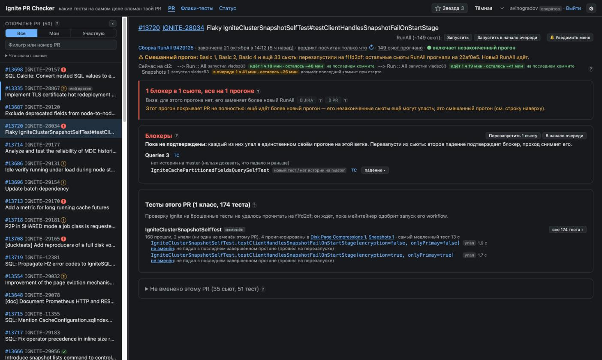
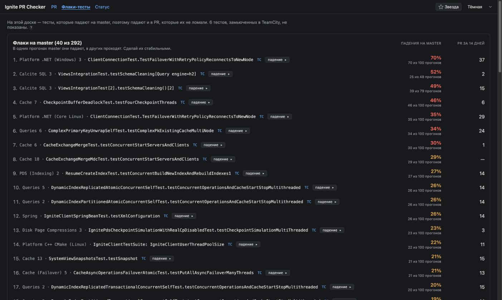
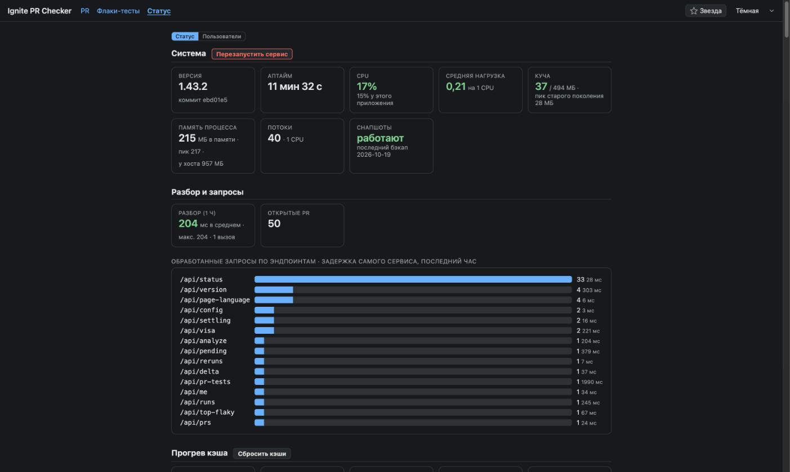

# Тур по возможностям

[English](features.md) · **Русский**

Что умеет Ignite PR Checker, экран за экраном. Скриншоты сделаны на рабочем инстансе в теме Dark; в селекторе в шапке
четыре темы: Light, Dark, JetBrains и Terminal.

## Словарь вердикта

Каждая метка, которую чекер ставит на PR, сьюту или тест: что она значит и что делать. Сюда ведут значки **?** на
странице, комментарий в PR и виза в JIRA. Числа — значения по умолчанию из кода, см. [Пороги](#пороги).

### Карточки на странице PR

| Карточка или заголовок | Что значит | Что делать |
|---|---|---|
| **Blockers** | На русской странице — «Блокеры». Тесты, которые этот PR, скорее всего, сломал: они падают в его прогонах, и ни master, ни другие PR этого не объясняют. Каждая сьюта оценивается отдельно. Строка под тестом или над тестами сьюты с общей причиной объясняет почему ([причины](#причины-под-тестом)). | Открой **failure ▸** или **TC**, исправь код, запушь, запусти RunAll снова. |
| **Not confirmed: 1 run** | На русской странице — «Не подтверждены: один прогон». Блокеры, которые упали в единственном своём прогоне на этой ветке. Они всё равно считаются блокерами: в счётчике, в значке списка PR, в визе и в комментарии. Заголовок группы уже говорит, что каждый её тест упал в единственном своём прогоне на этой ветке. Поэтому в строках тестов нет `failed the only run on this branch`, метки `1 run` и полоски из одной черты. Если каждый блокер упал в единственном своём прогоне на этой ветке, над списком Blockers стоит строка **Not confirmed yet**, а этой группы нет. | Нажми **Rerun** у их сьют. Второе падение подтверждает блокер, проход снимает его. |
| **Recently started failing** | На русской странице — «Недавно начали падать». Тесты, которые падают на коде, который проверял прогон, но прогонов этого кода слишком мало, чтобы отличить поломку от флака. Пока не блокеры. | Нажми **Rerun** у сьюты. Продолжит падать — станет блокером, пройдёт — уйдёт из списка. |
| **Could not be checked** | На русской странице — «Не удалось проверить». Упавшие тесты, которые из-за ошибок TeamCity не удалось сравнить с master и веткой. Блокерами не считаются. | Ничего: чекер проверит их снова сам. |
| **Broken suites** | На русской странице — «Битые сьюты». Сьюты без надёжного результата ([причины](#причины-битых-сьют)). Сьюта с таймаутом или падением JVM попадает сюда, и чекер не ищет в ней блокеры. Её падения могли случиться из-за таймаута или падения JVM, и часть тестов не запустилась. | Перезапусти их первыми: вердикт не видит их тестов. У сьюты, которая не скомпилировалась, кнопки **Rerun** нет: ей нужна правка кода. |
| **Fewer tests than master** | На русской странице — «Меньше тестов, чем на master». Сьюты, которые прогнали минимум на 10% меньше тестов, чем та же сьюта на master; сравниваются только сьюты, где на master 20 тестов и больше. Незапущенный тест упасть не может. | Если PR удаляет тесты намеренно — ничего. Иначе сравни список тестов с master и перезапусти. |
| **Crashed near the end of the run** | На русской странице — «Упали в конце прогона». Сьюты, которые упали по таймауту, из-за нехватки памяти или падения JVM, но уже прогнав больше 90% тестов master, и ни одно их падение не вменено PR. Их результаты в силе. Карточка свёрнута, число в заголовке. | Для PR — ничего. |
| **⚠ Suites that never ran** | На русской странице — «⚠ Сьюты, которые не запускались». RunAll прервали: эти сьюты отменили, и они не запускались. Вердикт о них ничего не говорит. Сьюты, отменённые человеком, свёрнуты в одну строку на человека. | Нажми **Rerun** у них или запусти RunAll снова. |
| **This PR's tests** | На русской странице — «Тесты этого PR». Как в этом RunAll прошли тестовые классы, которые PR добавляет (`new`) или меняет (`changed`). У каждого класса в списке стоят тесты, которые упали или шли дольше 60 с. Кнопка **all N tests** открывает все тесты класса с их статусом и временем. Имя теста открывает его прогон в TeamCity, имя сьюты — прогон сьюты. Строка под упавшим тестом говорит, что с ним сделал вердикт: `blocks this PR`, `recently started failing: …`, `could not be checked` или `not blamed: …`. Каждая пометка — ссылка на строку этого теста в своей карточке: **Blockers**, **Recently started failing**, **Could not be checked** или **Not blamed on this PR**. Вердикт не оценивает тест, если его сьюта прервалась по таймауту или из-за падения JVM (`not checked: its suite broke`). Падение, которое TeamCity замьютил, вердикт тоже не оценивает (`not checked: TeamCity muted it`). Падение, которое вердикт не оценил, помечено `not checked yet`, пока вердикт ещё может измениться: RunAll ещё идёт или чекер повторяет проверку после ошибок TeamCity. В окончательном вердикте и в вердикте смерженного PR оно помечено `not checked`. Строка класса подводит итог: что вердикт сделал с его падениями, например `3 failed (none blamed on this PR)` или `2 failed (2 not checked yet)`. Класс, которого собственная проверка Ignite на брошенные тесты не находит ни в одном наборе, помечен `not in any suite`. У класса без прогонов сказано, почему он не запускался, если это видно по проверке Ignite на брошенные тесты и по файлам, изменённым после прогона. Причины такие: коммит после прогона добавил класс или включил его в набор; сьюта класса не запускалась или сломалась; это базовый класс или класс с `@Ignore`. Если проверка и файлы больше ничего не говорят, заметка над списком один раз называет возможные причины для всех таких классов. Проверка Ignite на брошенные тесты может ещё идти, ждать одобрения мейнтейнера (пуш человека не из проекта), быть пропущенной или не читаться. Тогда заметка над списком говорит об этом и сколько классов не запускалось, если такие есть. Почему эти классы не запускались, карточка не пишет: без этой проверки причину не узнать. | Проверь, что новые тесты прогнались и прошли. Почини упавший тест с пометкой `blocks this PR`. Класс с `not in any suite` добавь в набор или пометь `@Ignore`. |
| **Not blamed on this PR** | На русской странице — «Не вменено этому PR». Падения, которые не ставятся в вину PR, у каждого своя причина: падает и на master, флакает или прошёл в более позднем прогоне. Карточка свёрнута. | Для этого PR — ничего. Перезапускай только чтобы перепроверить флакающие. Тесты, падающие на master, — на доске флаки (`/flaky.html`). |
| **✓ No blockers** | На русской странице — «✓ Блокеров нет». Прогон покрыл текущий код PR и ничего ему не вменил. В списке PR стоит **✓**. | Можно мержить. |
| **No proven blockers yet** | На русской странице — «Доказанных блокеров пока нет». Ни один тест не вменён, но на коде, который проверял прогон, начали падать тесты: они в карточке **Recently started failing**. В списке PR стоит **!**. | Нажми **Rerun** у их сьют: если тест продолжит падать, он станет блокером, если пройдёт — уйдёт из списка. |
| **No blockers found — not proven clean** | На русской странице — «Блокеров не нашлось — чистота не доказана». Ни один тест не вменён, но вердикт не может назвать PR чистым. Янтарные строки под заголовком говорят почему ([оговорки](#оговорки)). В списке PR стоит **?**. Пока страница проверяет, тестировал ли прогон последний коммит PR, в заголовке стоит **No blockers found**. | Разберись с тем, что перечислено в строках, и перезапусти. |

### Причины под тестом

Причина состоит из части про master и части про ветку, через `;`. `N`, `F/R` и `abc1234` — числа и коммит.
`on JDK 17` значит, что считались только прогоны master на JDK этого PR. Замьюченное падение не показывается
никогда, а прогон, где тест был проигнорирован, прогоном не считается.

| Причина | Что значит | Что делать |
|---|---|---|
| `not seen failing in N master runs` («ни разу не упал в N прогонах master») | На master тест прогнали в этой сьюте N раз (не больше последних 100), и он ни разу не упал. | Смотри часть про ветку. |
| `not seen failing in only N master runs on JDK 17` («ни разу не упал, но прогонов master на JDK X всего N») | То же, но прогонов master на JDK этого PR меньше 10: доводов мало. | Смотри часть про ветку. |
| `no master history (can't prove pre-existing)` («нет истории на master (нельзя доказать, что падало и раньше)») | На master нет ни одного прогона теста на JDK этого PR: новый тест или тест, который master не гоняет. Метка `new test / no master history`. | Убедись, что тест стабилен: судить о нём можно только по этому PR. |
| `rare on master: fails F/R, passed the last G` («редко на master: падает F/R, прошёл последние G») | На master тест падает не чаще чем в 2% прогонов и ни разу в последних 10, а падений подряд в PR слишком много для такой случайности. | Считай блокером. |
| `fails F/R on master at TEST_SCALE_FACTOR=1.0, but f/r on other PR branches at 0.1` («падает F/R на master при TEST_SCALE_FACTOR=…, но f/r на ветках других PR при …») | На master тест падает минимум в половине прогонов, но только на масштабе, с которым этот PR не гоняли. В других PR, прогнанных так же, он падает редко, а падений подряд в этом PR слишком много для их частоты. | Считай блокером. |
| `…; fails F/R in K other PRs` («…; падает F/R в K других PR», у блокера) | Тест падает ещё в 3 и более других PR, но падений подряд в этом PR слишком много для такой флакучести. | Считай блокером. |
| `failed all N runs on this branch`, `failed the last N of M runs on this branch` («упал во всех N прогонах на этой ветке», «упал в последних N из M прогонов на этой ветке») | Последние 3 завершённых прогона сьюты на ветке уронили тест, или все прогоны, если их меньше. Блокер. | Исправь код. |
| `failed the only run on this branch` («упал в единственном прогоне на этой ветке») | Тест прогнали на ветке один раз, и он упал. Блокер, ещё не подтверждённый. В строке под тестом этой части причины нет: заголовок **Not confirmed: 1 run** или строка **Not confirmed yet** над списком уже говорит об этом. | Нажми **Rerun** у сьюты, чтобы подтвердить. |
| `failed all N runs on commit abc1234` («упал во всех N прогонах на коммите …») | Все прогоны текущего кода PR уронили тест, и их было минимум 2. Блокер. | Исправь код. |
| `failed the only run on commit abc1234; the N earlier runs were on other code` («упал в единственном прогоне на коммите …; N прежних прогонов шли на другом коде») | Текущий код прогнали один раз, и тест упал; прежние прогоны шли на старом коде. Тест в карточке **Recently started failing**. | Нажми **Rerun** у сьюты. |
| `failed the latest run; TeamCity gave no commit for it, so the N earlier runs do not count` («упал в последнем прогоне; TeamCity не назвал для него коммит, поэтому N прежних прогонов не считаются») | Последний прогон упал, и TeamCity не назвал для него коммит. Прежние прогоны могли идти на другом коде, поэтому считается только последний. Тест в карточке **Recently started failing**. | Нажми **Rerun** у сьюты. |
| `failed the last N of M runs on commit abc1234, after a pass on the same commit` («упал в последних N из M прогонов на коммите …, после прохода на том же коммите») | Минимум 2 падения подряд на текущем коде после прохода на том же коде. Тест в карточке **Recently started failing**. | Нажми **Rerun** у сьюты. |
| `…; too few failures on this code yet to outweigh other PRs` («…; на этом коде пока слишком мало падений, чтобы перевесить другие PR») | Случай с масштабом выше, но падений пока мало, чтобы перевесить частоту в других PR. Тест в карточке **Recently started failing**. | Нажми **Rerun** у сьюты. |
| `pre-existing: fails F/R on master` («было и раньше: падает F/R на master») | Тест падает и на master. Тест в карточке **Not blamed on this PR**. | Для PR — ничего. |
| `flaky on other PR branches: fails F/R in K other PRs; …` («флаки на ветках других PR: падает F/R в K других PR; …») | Тест падает в 3 и более других PR, и падений в этом PR не хватает, чтобы это перевесить. Тест в карточке **Not blamed on this PR**. | Для PR — ничего. |
| `flaky on branch: failed only the latest of N runs on commit abc1234 (an earlier run on the same code passed)` («флаки на ветке: упал только в последнем из N прогонов на коммите … (более ранний прогон на том же коде прошёл)») | Тест упал один раз после прохода на том же коде. Тест в карточке **Not blamed on this PR**. | Ничего или перезапусти для верности. |
| `not failing in the last finished run (passed on re-run)` («не падал в последнем завершённом прогоне (прошёл на перезапуске)») | Последний завершённый прогон теста на ветке прошёл. Тест в карточке **Not blamed on this PR**. | Ничего. |
| `could not verify (TeamCity error: …)` («не удалось проверить (ошибка TeamCity: …)») | Проверку оборвала ошибка TeamCity. Тест в карточке **Could not be checked**. | Ничего: проверка повторится. |
| `the N earlier runs were on other code` («N прежних прогонов шли на другом коде») | Прогоны на старом коммите не считаются; в полоске они бледные. | — |
| `passed just before, but TeamCity gave no commits to prove that was the same code`, `after a pass; TeamCity gave no commits to prove that was the same code` («перед этим прошёл, но TeamCity не назвал коммитов, чтобы доказать, что код был тем же», «после прохода; TeamCity не назвал коммитов, чтобы доказать, что код был тем же») | TeamCity не назвал коммит ни для одного прогона теста на ветке, поэтому тест мог пройти на другом коде. | — |
| `revision`, `run(s)`, `— watch` в вердикте смерженного PR | Смерженный PR хранит вердикт на момент мержа в формулировках выпуска чекера, который этот вердикт посчитал. | — |

### Оговорки

Янтарные строки под заголовком вердикта и список под «This run doesn't cover the PR fully» в комментарии и визе.

| Оговорка | Что значит | Что делать |
|---|---|---|
| `Build failed — N suites that need it did not run` («Build упала — N сьют, которым она нужна, не запустились») | Упал прогон, который нужен остальным сьютам, и они не запускались. | Почини сборку, запушь, запусти RunAll снова. |
| `the RunAll was interrupted — N suites never ran` («RunAll прервали — N сьют не запустились») | Сьюты отменили до запуска. | Нажми **Rerun** у них или запусти RunAll снова. |
| `N suites have no reliable result (…)` («у N сьют нет надёжного результата (…)») | Битые сьюты; причины в скобках. | См. [причины битых сьют](#причины-битых-сьют). |
| `N suites ran fewer tests than the same suites on master` («N сьют прогнали меньше тестов, чем те же сьюты на master») | См. **Fewer tests than master**. | Сверь списки тестов, перезапусти. |
| `N failed tests could not be checked (TeamCity errors)` («N упавших тестов не удалось проверить (ошибки TeamCity)») | См. **Could not be checked**. Виза, комментарий в PR и автоперезапуск ждут повторной проверки до 20 минут, потом идут дальше и перечисляют такие тесты отдельно. | Подожди. |
| `a newer run is still going — its unfinished suites can still fail` («ещё идёт более новый прогон — его незаконченные сьюты ещё могут упасть») | В вердикт подмешан RunAll, который ещё идёт. | Дождись его конца. |
| `N commits pushed since this run — it tested older code`, `new commits pushed since this run — it tested older code` («после этого прогона запушено N коммитов — он тестировал старый код», «после этого прогона запушены новые коммиты — он тестировал старый код») | HEAD PR сдвинулся после прогона. Так пишут комментарий и виза; страница пишет `it tested older code (see the note at the top)`, а строка наверху называет оба коммита и, когда ответит GitHub, их число. | Запусти RunAll снова. |
| `mixed run — Cache 2 re-ran on abc1234, the rest of the RunAll ran on def5678; only a RunAll of the PR's head can prove it clean` | Смешанный прогон: вердикт учитывает прогоны части сьют на другом коммите, чем остальной RunAll, поэтому ни один коммит не проверен целиком. Так пишут комментарий и виза вместо оговорки о запушенных коммитах; страница пишет `it is a mixed run (see the note at the top)`, а строка наверху говорит, какой коммит — HEAD PR. | Запусти RunAll на HEAD PR. |
| `could not check whether the PR changed since this run` («не удалось проверить, менялся ли PR после этого прогона») | Только на странице: GitHub или ci2 не ответил, тот ли ещё коммит в HEAD PR, что проверял прогон, поэтому страница не называет вердикт чистым. То же бывает, пока у чекера остаётся меньше пятой части часового лимита вызовов GitHub: тогда страница не спрашивает об этом GitHub. | Обнови страницу через минуту. Если карточка **GitHub API** на странице статуса показывает, что осталось меньше пятой части вызовов, дождись, пока GitHub восстановит часовой лимит. |

### Причины битых сьют

| Причина | Что значит | Что делать |
|---|---|---|
| `compilation error` («ошибка компиляции») | Код сьюты не скомпилировался. Кнопки **Rerun** у неё нет: тот же код упадёт так же. | Почини сборку, запушь, запусти RunAll снова. |
| `execution timeout` («таймаут выполнения») | Сьюта не уложилась во время. Её падения — скорее всего каскад от зависания, и часть тестов не запустилась. | Перезапусти. Если таймаут повторится, смотри дамп потоков в TeamCity. |
| `JVM crash / out of memory` («падение JVM / нехватка памяти») | JVM упала посреди прогона. | Перезапусти. Если повторится, ищи падение или утечку в логе сборки. |
| `non-zero exit code` («ненулевой код выхода») | Сборка завершилась с ошибкой, и ни один незамьюченный тест не упал. | Открой **TC** и посмотри, что упало. |
| `failed dependency` («упала зависимость») | Упал прогон, от которого зависит эта сьюта. | Сначала почини тот прогон. |
| `failed without running tests` («упала, не запустив тестов») | TeamCity не назвал проблему, и ни один тест не упал. | Открой **TC**, перезапусти. |
| `ci2 glitch: artifacts unavailable (N suites)` («сбой ci2: артефакты недоступны (N сьют)») | TeamCity не отдал этим сьютам артефакты нужного им прогона, хотя тот прошёл. | Перезапусти: обычно со второго раза артефакты доходят. |
| `Build failed — N suites that need it did not run; fix the build, then /run-all` («Build упала — N сьют, которым она нужна, не запустились; почини сборку, потом /run-all») | Упал шаг сборки, и сьюты, которым он нужен, не запускались. `nothing else ran` — если в цепочке больше ничего и не было. | Почини сборку, запушь, `/run-all` или **Run**. |
| `Build failed in this run and passed on a re-run since — N suites that need it never ran; /run-all to run them` («Build упала в этом прогоне и с тех пор прошла на перезапуске — N сьют, которым она нужна, так и не запустились; /run-all, чтобы их запустить») | Сборка теперь проходит, но у сьют, которым она нужна, нет результата. | `/run-all` или **Run**. |
| `— ran 33 of master's 67 tests` (после причины), `ran 33 of master's 67 tests` (отдельно), `ran fewer tests than on master` (группа); по-русски «прогнала N из M тестов master» и «прогнали меньше тестов, чем на master» | Сколько тестов битая сьюта успела прогнать. Недобор объясняется причиной, а не пропажей тестов. Если TeamCity не сообщил ничего, кроме своего подсчёта этого недобора, строка говорит только, сколько тестов сьюта успела прогнать. Несколько таких сьют с разным недобором стоят под общей строкой `ran fewer tests than on master`, и у каждой сьюты остаются её числа. Если в подсчёте TeamCity другие числа, строка показывает его как причину: TeamCity сравнивал с прогоном, который выбрал сам. | — |
| что угодно другое | Первая строка текста проблемы от самого TeamCity. | Открой **TC**. |

### Метки у теста

| Метка | Что значит | Что делать |
|---|---|---|
| полоска | Завершённые прогоны теста в его сьюте на ветке, от старых к новым: красный — упал, зелёный — прошёл. Бледные прогоны шли на старом коде, яркие — на коде последнего прогона. Полоски из одной черты нет под **Not confirmed: 1 run** и **Not confirmed yet**: их заголовки уже говорят, что каждый тест под ними упал в единственном прогоне на этой ветке. | — |
| `flaky?` («флаки?») | Тест упал, а потом прошёл на том же коде. | Ищи гонку или проблему со временем. |
| `1 run` («один прогон») | Этот код прогнали один раз, и тест упал. Метки нет под **Not confirmed: 1 run** и **Not confirmed yet**: это уже сказано в их заголовках. | Нажми **Rerun** у сьюты: он подтвердит или снимет. |
| `new test / no master history` («новый тест / нет истории на master») | На master нет прогонов теста на этом JDK для сравнения: новый тест или тест, который master не гоняет. | Убедись, что тест стабилен. |
| `not in any suite` («нет ни в одном наборе», у тестового класса) | Собственная проверка Ignite (job Check java code в GitHub Actions, шаг «Run abandoned tests checks.») не находит класс ни в одном наборе тестов, так что CI его никогда не запустит. Видно в **This PR's tests**; комментарий PR и виза говорят это тоже, а вердикт от этого не меняется. | Добавь класс в набор тестов или пометь `@Ignore`, или включи в ⚙ **Add my PR's tests that no suite runs**. |
| `unverified` («не проверен») | Ошибка TeamCity не дала довести проверку: прогоны теста в других PR. Чекер попробует снова. | Подожди. |
| `⚖ assertion — likely a real logic failure` («⚖ упал assert — скорее всего, настоящая ошибка логики», в **failure ▸**) | Упал assert в тесте. | Исправь код. |
| `environment/timing — a re-run may pass` («окружение/время — перезапуск может пройти») | Проблема окружения или времени. | Перезапусти. |
| `environment/timing — but it failed all N runs of this code, …` («окружение/время — но тест упал во всех N прогонах этого кода, …») | То же, но упали все прогоны этого кода. | Один перезапуск вряд ли поможет: чини. |
| `⌛ hang — the test ran out of time; …` («⌛ зависание — тест не уложился во время; …») | Тест завис. Показан его поток из дампа потоков. | Посмотри, чего этот поток ждёт. |
| **failure ▸** / **copy failure** / **copy AI prompt** | На русской странице — «падение ▸», «копировать падение» и «копировать промпт для ИИ». **failure ▸** раскрывает панель с сообщением о падении и стектрейсом. В панели **copy failure** копирует сообщение, а **copy AI prompt** — промпт для ассистента-кодера с задачей починить тест. Если сообщения о падении нет, **copy AI prompt** стоит прямо в строке. | — |

### Значки в списке PR

| Значок | Что значит | Что делать |
|---|---|---|
| красное число | Блокеры в последнем разобранном RunAll этого PR. | Открой PR. |
| **!** | Блокеров пока нет, но на коде, который проверял прогон, начали падать тесты. | Перезапуск покажет, блокеры ли эти тесты. |
| **?** | Блокеров не нашлось, но доказать, что PR чист, нельзя. Либо прогон этого не доказывает ([оговорки](#оговорки)): его прервали; сьюты сломались; сьюты прогнали меньше тестов, чем на master; упавшие тесты не удалось проверить; сьюты перезапустили на других коммитах; ещё идёт более новый прогон. Либо после прогона запушили коммиты. Либо неизвестно, тестировал ли прогон последний коммит PR. | Открой PR, там написана причина. |
| **✓** | Чистый прогон текущего кода PR. | — |
| **…** | Только у PR, открытого на странице: блокеров не нашлось, и страница ещё проверяет, тестировал ли прогон последний коммит PR. Когда она узнает, значок станет **✓** или **?**. | Подожди. |
| нет значка | Вердикта ещё нет. | Открой PR, чтобы разобрать. |
| **my run** | На русской странице — «мой прогон». Последний RunAll запустил ты, а у PR клиента Python — последний прогон сьюты. PR может быть чужим. | — |

### Прогоны, кнопки и визы

| Метка | Что значит | Что делать |
|---|---|---|
| `queued`, `running` («в очереди», «идёт») | Сборка этого PR на ci2 прямо сейчас, под **On ci2 now**. Время рядом — сколько она уже ждёт или идёт; `~14m left` и `starts ~5m` — оценки по очереди и прогрессу сьюты. | — |
| `on latest commit` («на последнем коммите») | Прогон тестирует последний коммит PR. | — |
| `⚠ old commit abc1234` («⚠ старый коммит …») | Коммиты запушили после старта прогона: он тестирует старый код. | Когда это важно, запусти RunAll снова. |
| `takes latest commit at start` («возьмёт последний коммит при старте») | Прогон ещё в очереди; TeamCity возьмёт последний коммит PR, когда прогон запустится. | — |
| `by alice` («запустил alice») | Этот прогон запустил кто-то другой. **Cancel my runs** его не трогает. | — |
| `● includes an unfinished run` («● включает незаконченный прогон») | В вердикт подмешаны завершённые сьюты RunAll, который ещё идёт. Такой вердикт никогда не бывает зелёным. | Дождись конца прогона. |
| `6 suites ran, 141 reused from earlier runs` («N сьют прогнано, M взято из прежних прогонов») | Сколько сьют цепочки прогнали, а сколько TeamCity взял из прежних прогонов того же коммита. Показывается, когда что-то взято из прежних прогонов или пока прогон ещё идёт. | — |
| `Blockers since the previous RunAll: 2 new · 3 dropped out · 5 still blocking` («Блокеры по сравнению с предыдущим RunAll: N новых · M выбыли · K блокируют по-прежнему») | Блокеры в сравнении с предыдущим RunAll этого PR, по сьютам. `dropped out` — больше не блокер: прошёл, перешёл в другой список или не запускался. Нулевые `dropped out` и `still blocking` строка не показывает, а ноль новых показывает как `no new`. Если все три нули, строки нет. От трёх RunAll рядом стоит столбик на прогон. | — |
| `⚠ The verdict is for older code` («⚠ Вердикт для старого кода») | Прогон тестировал коммит старее, чем HEAD PR; строка называет оба коммита. Пока новый RunAll стоит в очереди или идёт, она пишет об этом, а кнопку не предлагает. У смерженного PR строка только называет коммит прогона и коммит, на котором PR смержили, без кнопки. | **Run RunAll**. |
| `⚠ Mixed run` («⚠ Смешанный прогон») | Вердикт учитывает прогоны части сьют на другом коммите, чем остальной RunAll. Строка говорит, какие сьюты перезапустили на каком коммите, какой коммит — HEAD PR и что доказать чистоту PR может только RunAll его HEAD. Она стоит вместо `⚠ The verdict is for older code`. Пока новый RunAll стоит в очереди или идёт, она пишет об этом, а кнопку не предлагает. У смерженного PR она называет коммит, на котором PR смержили, без кнопки. | **Run RunAll**. |
| `♻︎ Auto re-run #1 of up to 2`, `♻︎ Deciding whether to re-run the failed suites` («♻︎ Автоперезапуск №N из M возможных», «♻︎ Решаю, перезапускать ли упавшие сьюты») | Автоперезапуски ещё уточняют этот прогон: вердикт может измениться. | Подожди. **🔔 Notify me** скажет, когда он окончательный. |
| **Run**, **Run at top** | На русской странице — «Запустить» и «Запустить в начало очереди». Поставить новую цепочку RunAll для PR в конец или в голову очереди ci2. Всегда спрашивает. | — |
| **Run anyway** | На русской странице — «Всё равно запустить». В PR, где GitHub сообщает о конфликтах слияния, **Run**, **Run at top** и **Run RunAll** ничего не ставят в очередь. Строка статуса говорит об этом, а рядом появляется эта кнопка. Она сначала спрашивает, потом всё равно ставит этот RunAll. | Разреши конфликты и запусти RunAll снова. |
| **Rerun**, **Rerun at top** | На русской странице — «Перезапустить» и «В начало очереди». Перезапустить сьюту или все сьюты раздела: кнопка раздела называет число сьют, а у строки сьюты своя пара текстовых кнопок. Пара, которая перезапустила бы те же сьюты, что пара над ней, не показывается. Одна кнопка выделена цветом как следующий шаг: **Run RunAll** при старом коде, иначе битые или незапущенные сьюты, иначе блокеры на одном прогоне. У смерженного PR ни одна кнопка не выделена. От пяти сьют спрашивает. Если сьюты не встали в очередь или встали в её конец, а не в начало, строка под кнопками говорит почему. | — |
| **Cancel my runs** | На русской странице — «Отменить мои прогоны». Отменяет сборки, которые ты запустил в этом PR. | — |
| `Visa: posted to IGNITE-12345` («Виза: отправлена в IGNITE-…») | Виза этого прогона уже в тикете. Ключ ведёт на комментарий. | — |
| `Visa: will be posted to IGNITE-12345 when the run settles` («Виза: уйдёт в IGNITE-…, когда прогон устоится») | Прогон запустил ты, и твоя **Visa my runs in JIRA** включена. Виза уйдёт, когда прогон и его автоперезапуски устоятся. | Подождать. |
| `Visa: JIRA did not take it, the checker tries again every 10 minutes` («Виза: JIRA её не приняла, чекер пробует снова каждые десять минут») | Прогон запустил ты. Он устоялся, но JIRA не приняла визу. Попытки идут, пока опция включена и более новый RunAll не заменил прогон. | Подождать. |
| `Visa: bob, who started this run, has Visa my runs in JIRA on` («Виза: у запустившего этот прогон bob включена опция „Ставить визу моим прогонам в JIRA“») | Визу прогона отправляет только опция того, кто его запустил, и у bob она включена. Больше строка ничего о чужой опции не говорит. | — |
| `Visa: Visa my runs in JIRA is off in ⚙` («Виза: опция „Ставить визу моим прогонам в JIRA“ выключена в ⚙») | Этот прогон запустил ты, а твоя опция выключена. Если строка кончается словами `because JIRA rejected your token`, JIRA отвергла твой хранимый токен, и опция от этого выключилась. | Включить её в ⚙ с токеном JIRA. |
| `Visa: none, bob started this run and has Visa my runs in JIRA off` («Виза: нет, у запустившего этот прогон bob опция „Ставить визу моим прогонам в JIRA“ выключена») | Визу прогона отправляет только опция того, кто его запустил, а у bob она выключена. | Запустить RunAll самому с включённой опцией. |
| `Visa: waits until you log in again` («Виза: ждёт, пока ты снова войдёшь») | Прогон запустил ты, а TeamCity отверг токен, на котором работают твои опции, и они на паузе. Виза уйдёт после входа со свежим токеном, если более новый RunAll не заменил этот прогон. | Войти снова. |
| `Visa: waits until you save your JIRA token in ⚙ again` («Виза: ждёт, пока ты снова сохранишь токен JIRA в ⚙») | Прогон запустил ты, а состояние чекера восстановили из бэкапа старше 2 дней, в котором нет токенов. Твоя опция включена и ждёт токен JIRA. Виза уйдёт, когда ты его сохранишь, если более новый RunAll не заменил этот прогон. | Сохранить токен JIRA в ⚙. |
| `Visa: waits for a new JIRA token in ⚙` («Виза: ждёт новый токен JIRA в ⚙») | Прогон запустил ты, а чекер не смог прочитать токен JIRA, который хранила твоя Visa my runs in JIRA: ключ сервера сменили, или токен повреждён. Опция остаётся включённой. Виза уйдёт, когда ты сохранишь новый токен, если более новый RunAll не заменил этот прогон. | Сохранить новый токен JIRA в ⚙. |
| `Visa: none, this run finished before you switched on Visa my runs in JIRA` («Виза: нет, этот прогон закончился до того, как ты включил опцию „Ставить визу моим прогонам в JIRA“») | Опция действует только на прогоны, которые закончились после её включения. | Запустить RunAll снова. |
| `Visa: none, the PR title named no IGNITE ticket when the run settled` («Виза: нет, когда прогон устоялся, в заголовке PR не было тикета IGNITE») | Если вписать ключ в заголовок после того, как прогон устоялся, виза этого прогона не уйдёт. | Запустить RunAll снова. |
| `Visa: none, this run was cancelled` («Виза: нет, этот прогон отменили») | Отменённый прогон визу не получает. Страница показывает отменённый прогон, только если все законченные прогоны PR отменены. | Запустить RunAll снова. |
| `Visa: none for this run, a newer RunAll replaces it` («Виза: для этого прогона нет, его заменяет более новый RunAll») | Визу получит более новый RunAll этого PR. | — |
| `Visa: none, the PR is closed` («Виза: нет, PR закрыт») | PR закрыли или влили раньше, чем ушла виза этого прогона. | — |
| `Visa: unknown, TeamCity does not say who started this run` («Виза: неизвестно, TeamCity не говорит, кто запустил этот прогон») | Визу отправляет только опция запустившего, а TeamCity его не назвал. | — |
| `Visa: the PR title names no IGNITE ticket` («Виза: в заголовке PR нет тикета IGNITE») | Виза уходит в тикет IGNITE, названный в заголовке PR. Ключ может быть в любом регистре. Для PR, которого нет в левой панели, строка появляется вместе с заголовком PR. | Вписать ключ в заголовок PR. |
| **Visa my runs in JIRA** (⚙) | В ⚙ на русской странице — «Ставить визу моим прогонам в JIRA». Когда твой RunAll заканчивается, его вердикт уходит в тикет IGNITE, названный в заголовке PR, один раз на прогон; если включён и автоперезапуск — когда перезапуски улягутся. В заголовке нужен ключ IGNITE-NNNN: нет ключа — нет визы. Пока идёт более новый RunAll этого PR, визы нет, и чекер не повторяет прошлую визу того же коммита. | — |

### Пороги

| Что | По умолчанию | Где видно |
|---|---|---|
| Сколько прогонов master смотреть на тест в сьюте | 100 (`MASTER_HISTORY_DEPTH`) | `pre-existing`, `not seen failing in N master runs` |
| Сколько падений подряд на ветке дают блокер | 3, или все прогоны, если их меньше (`BLOCKER_FAIL_STREAK`) | `failed all N runs on this branch` |
| Мало истории на master | меньше 10 прогонов master на JDK этого PR | `only N master runs` |
| Редкое падение на master | не больше 2% прогонов master и ни одного в последних 10 | `rare on master` |
| Слишком много падений для случайности | вероятность не больше 1 к 10 000: 2 подряд против 1%, 3 против 2%, 5 против 12,5% | `rare on master`, причины про другие PR и масштаб |
| Флаки в других PR | падает в 3 и более других PR | `flaky on other PR branches` |
| Падения master списываются на масштаб | master падает минимум в половине прогонов, только на другом масштабе, а в других PR прогонов минимум 10 | `fails F/R on master at TEST_SCALE_FACTOR=1.0` |
| Меньше тестов, чем на master | минимум на 10% меньше, для сьют с 20 и более тестами на master | **Fewer tests than master** |
| Упавшая сьюта, чьи результаты в силе | прогнала больше 90% тестов master | **Crashed near the end of the run** |
| Сколько придерживают неполный вердикт | 20 минут | **Could not be checked** |
| Медленный тест PR | дольше 60 с | **This PR's tests** |
| Перезапуск, который спрашивает | 5 сьют | **Rerun N suites** |

## Найти свой PR

- Левая панель — открытые PR репозитория, сверху те, что обновлялись последними. В строке — номер PR, ключ тикета и
  значок с последним известным вердиктом ([значки](#значки-в-списке-pr)). Свёртка **What the badges mean** под
  фильтром объясняет значки. Пока PR не выбран, она раскрыта. **my run** отмечает PR, чей последний RunAll запустил ты.
- Над списком три вкладки: ими ты выбираешь, какие PR в нём видны. «Все» (**All**) — 50 открытых PR, которые обновлялись
  последними. «Мои» (**Mine**) — твои открытые PR, в том числе те, что не попали в эти 50. «Участвую» (**Involved**) —
  чужие открытые PR, где тебя позвали на ревью, ты ревьюил или комментировал. «Мои» и «Участвую» чекер находит поиском
  GitHub, не чаще раза в минуту для каждого пользователя. PR не из этих 50 получает значок, когда его кто-нибудь откроет
  здесь.
- «Мои» и «Участвую» работают, только когда твой аккаунт GitHub привязан в ⚙ ([аккаунт GitHub](#аккаунт-github)). Без
  привязки они выглядят неактивными, а щелчок по ним открывает ⚙. Список открывается на вкладке, которую ты выбрал в
  этом браузере последней. Пока ты ни разу не выбирал вкладку в этом браузере, список открывается на вкладке «Мои», если
  аккаунт GitHub привязан, иначе на «Все».
- Фильтр (**Filter, or a PR number**) сужает список выбранной вкладки по номеру или заголовку. Номер, которого в списке
  нет, предлагается как **Open PR #N →**. `Enter` открывает его или первое совпадение, `Escape` очищает фильтр, а `/`
  переводит в него из любого места страницы.
- Каждый PR в списке — ссылка (`?pr=13655`), так что средний клик открывает его в новой вкладке. В адресе работает
  любой номер PR, в том числе того, которого нет в списке.
- Открытые PR тонкого клиента Python стоят в своей группе «Клиент Python» (**Python client**) под PR Ignite, с теми
  же значками и вкладками. Номера их PR совпадают с номерами PR Ignite, поэтому адрес такого PR называет репозиторий:
  `?repo=python&pr=69`. Фильтр понимает `python#69` как PR #69 клиента, а номер без приставки — как PR Ignite.
  Подробнее — в разделе [PR тонкого клиента Python](#pr-тонкого-клиента-python).
- Ширину панели меняет перетаскивание разделителя, двойной клик по нему её сбрасывает, а `‹` / `›` сворачивают
  панель. На экране уже 768 px список сворачивается, когда открывается PR.

## Прочитать вердикт

Страница отвечает на один вопрос: какие тесты сломал этот PR? Первой на него отвечает карточка вердикта, словами
комментария в PR и визы. [Карточки](#карточки-на-странице-pr) под ней идут от того, что делает прогон ненадёжным
(сьюты, которые не запускались, битые сьюты, меньше тестов, чем на master), к блокерам, тестам, которые недавно
начали падать, собственным тестам PR и тому, что PR не вменено.

- **Шапка** называет PR: его номер — ссылка на GitHub, тикет IGNITE — ссылка на JIRA, рядом кнопки RunAll. Строка
  под ней называет сборку RunAll со ссылкой на TeamCity, когда закончился прогон и когда посчитан вердикт. Время конца
  прогона выделено янтарным, если прогону больше недели. Кнопка ↻ в этой строке считает вердикт снова. Если TeamCity
  взял сьюты из прежних прогонов, в строке ещё стоит `135 suites ran, 12 reused from earlier runs`.
- **Строки под шапкой** говорят, что вердикт про старый код или это смешанный прогон, что автоперезапуски ещё
  доводят прогон и что сейчас идёт на ci2. У смерженного PR карточка вердикта говорит, что это вердикт на момент
  мержа: он хранится и не пересчитывается, потому что история master теперь содержит собственные прогоны этого PR.
  Новые прогоны его не меняют, поэтому ни одна кнопка не закрашена и ни одна строка не обещает, что перезапуск его
  изменит. Единственное исключение — прогоны, поставленные до мержа и ещё шедшие в момент мержа. Когда последний из
  них закончится, чекер посчитает вердикт ещё раз по прогонам, поставленным до мержа, и прогонам master, закончившимся
  до него, а карточка назовёт эти прогоны.
- **Какой прогон.** Чекер разбирает самый свежий завершённый и не отменённый RunAll этого PR; если такого нет — самый
  свежий отменённый; если нет и его — тот, что ещё идёт. Завершённые сьюты идущей цепочки — настоящие результаты, так
  что первый RunAll PR показывает падения за часы до своего конца. Пока идёт более новый RunAll, его завершённые сьюты
  вливаются в вердикт с пометкой `● includes an unfinished run`. Такой вердикт никогда не бывает зелёным, а визы и
  комментарии в PR ждут завершённую цепочку.
- **Перезапуски считаются.** Сьюта, перезапущенная отдельно, руками или автоперезапуском, входит в вердикт, если её
  прогон новее прогона этой сьюты в цепочке. Проход на перезапуске снимает блокер; битая сьюта, чей полный перезапуск
  не сломался, оценивается по этому прогону. Перезапуск на другом коммите, чем RunAll, делает вердикт смешанным
  прогоном, а такой вердикт никогда не бывает зелёным: остальные сьюты этот коммит не проверяли.
- **Каждая сьюта отдельно.** Один тест может идти в нескольких сьютах (тесты C++ идут на Windows, Linux и Clang). Он
  указан в каждой сьюте, где упал, с вердиктом этой сьюты, так что проход на Windows не прячет устойчивую поломку на
  Linux.
- **Тот же код, тот же JDK.** Каждый прогон сверяется с коммитом, который он собрал: проход на старом коде падение не
  снимает, и такие прогоны приглушены в полоске теста. Прогоны master считаются только на JDK прогона PR. Прогон, в
  котором тест был проигнорирован, — не прогон, а падение, замьюченное в TeamCity, никогда не попадает в список.
- **Группировка по сьюте.** В списках тестов строки сгруппированы по сьютам. **TC** у сьюты открывает её последний
  прогон, **TC** у строки — прогон, в котором тест упал. Если у всех тестов сьюты одна причина, она стоит один раз над
  ними. Если причин несколько, причина, общая для нескольких тестов, стоит строкой над ними, а причина одного теста —
  строкой под ним. Группы идут по убыванию числа тестов. Имя теста — простой текст, `Class.method` с параметрами,
  полное имя — в подсказке. Из параметров страница убирает рабочую папку агента TeamCity.
- **Полоска** рядом с тестом показывает его завершённые прогоны в этой сьюте на ветке, от старых к новым. Проход после
  падения на том же коде даёт метку `flaky?`.
- **Битые сьюты** сгруппированы по причине. Первым идёт упавший Build вместе со сьютами, которым он нужен и которые не
  запустились. Потом сбой артефактов ci2, потом остальное по тексту проблемы из TeamCity. У группы одна кнопка
  **Rerun** на все её сьюты; сьюта, которая не скомпилировалась, её не получает: тот же код упадёт так же.
- **У блокеров** два вида: **Suites** и **Root causes** — те же блокеры, сгруппированные по сигнатуре падения.
  Число причин во вкладке Root causes появляется, когда кто-то уже открыл её для этих блокеров. Причина называет,
  сколько тестов делят сигнатуру, и сьюты, если их больше одной. Блокеры, для чьих падений TeamCity больше не хранит
  сообщение, там перечислены отдельно, с подсказкой перезапустить их сьюты.
- **This PR's tests** показывает, как прошли тестовые классы, которые PR добавляет или меняет: каждый класс с числом
  прошедших, упавших и проигнорированных тестов и самым медленным тестом, а также тесты, которые упали или шли дольше
  60 с. **all N tests** открывает весь список класса: сначала упавшие тесты, потом медленные, потом остальные по
  имени. Имена тестов и сьют открывают их прогоны в TeamCity. Под упавшим тестом строка говорит, что с ним сделал
  вердикт. Её ссылка ведёт к строке теста в карточке, куда его отнёс вердикт, и раскрывает карточку, если она
  свёрнута. Карточка **This PR's tests** может появиться чуть позже вердикта. Под ней стоят две карточки: **Crashed
  near the end of the run** и **Not blamed on this PR**. Они ждут ответа сервера о тестах PR, чтобы эта карточка их не
  сдвигала. Если ответа нет 20 с, они появляются без него. Когда приходит вердикт нового RunAll, карточка остаётся на
  месте с прежними тестами, пока не придут новые. Она говорит, что это тесты более раннего RunAll, и не пишет, что с
  ними сделал старый вердикт. Если новые тесты не пришли, страница прячет карточку.
- **✓ No blockers** стоит в заголовке карточки вердикта только у вердикта, которому список PR ставит галочку:
  прогон текущего head этого PR, который покрыл всё и ничего ему не вменил. Без галочки в заголовке стоит
  **No proven blockers yet**, если на проверенном коде начали падать тесты. Без галочки и без таких падений в заголовке
  стоит **No blockers found — not proven clean**. Янтарные строки под заголовком перечисляют оговорки теми же словами,
  что комментарий в PR и виза. Страница спрашивает GitHub, тестировал ли прогон HEAD PR. Пока GitHub не ответил, чистый
  вердикт выглядит как **No blockers found** со строкой `Checking that this run tested the PR's latest commit…`, а
  значок PR в списке — **…**; после ответа значок говорит то же, что страница.
- **failure ▸** раскрывает сообщение о падении и стектрейс с грубой меткой триажа: `⚖ assertion …`,
  `environment/timing …` или `⌛ hang …`. Вывод длиннее 32 000 символов обрезается; целиком он остаётся в TeamCity.
  **copy failure** в раскрытой панели копирует сообщение.
- **copy AI prompt** копирует промпт для ИИ-ассистента. Кнопка стоит в раскрытой панели, а если TeamCity не
  сохранил сообщение о падении, — прямо в строке. В промпте — PR, сьюта и её прогон, тест, вердикт чекера с причиной,
  метка триажа и вывод падения. Ещё промпт объясняет, как воспроизвести падение на коммите, который проверял прогон,
  с шагами для Java, .NET, C++, Python, Node.js или PHP по сьюте.
  Всё, что процитировано из PR, помечено как данные, а не инструкции, и промпт просит запускать код PR в изолированной
  среде. На вкладке Root causes **copy AI prompt** копирует один промпт на все тесты причины; у битых сьют и сьют с
  меньшим, чем на master, числом тестов свой **copy AI prompt**.
- **Вкладка** показывает в заголовке и значке, как идёт прогон: `⏱ ~1h 05m left`, `♻️ re-run 1/2`, потом
  `❌ 3 blockers`, `✅ no blockers`, `⚠ started failing` или `⚠ not proven clean`. **🔔 Notify me** присылает одно
  уведомление на рабочий стол, когда вердикт окончательный; вкладка должна оставаться открытой. Пока уведомление
  включено, кнопка залита и называется `🔔 Will notify`.

## Итерации над фиксом

- **Blockers since the previous RunAll**: `2 new · 3 dropped out · 5 still blocking` в карточке вердикта — блокеры в
  сравнении с предыдущим RunAll этого PR (имена тестов в подсказках); от трёх прогонов рядом по столбику на RunAll,
  красный, пока блокеры есть. Блокер — это тест в сьюте, так что тест, выбывший на Linux, считается выбывшим там, даже
  если на Windows ещё падает.
- **Run** и **Run at top** ставят новый RunAll этого PR в конец или в начало очереди ci2. Они всегда сначала
  спрашивают и называют размер цепочки. Если твой RunAll этого PR ещё идёт, OK отменяет его и ставит новый; чужой
  RunAll остаётся. Переставлять очередь ci2 разрешает не всем аккаунтам: остальным TeamCity ставит цепочку в конец
  очереди, и страница об этом пишет.
- В PR, где GitHub сообщает о конфликтах слияния, **Run**, **Run at top** и **Run RunAll** ничего не ставят и говорят
  почему. «Всё равно запустить» (**Run anyway**) рядом с этим ответом спрашивает ещё раз и ставит RunAll. Пока
  GitHub не выяснил, есть ли у PR конфликты, **Run**, **Run at top** и **Run RunAll** ставят RunAll как обычно. Пока у
  чекера остаётся меньше пятой части часового лимита вызовов GitHub, страница не спрашивает GitHub о конфликтах. Тогда
  эти кнопки тоже ставят RunAll как обычно. Конфликты слияния не мешают **Rerun**: он перезапускает сьюты прогона,
  который у PR уже есть.
- **Rerun** и **Rerun at top** перезапускают одну сьюту, все сьюты раздела или группу битых сьют. У строки сьюты своя
  пара текстовых кнопок, а кнопка раздела называет, сколько сьют она перезапустит. Пара, которая перезапустила бы то
  же, что пара над ней, не показывается. Одна кнопка закрашена: это следующий шаг; у смерженного PR — ни одна. С 5 сьют
  они сначала спрашивают.
  Твой одинаковый перезапуск, который ещё в очереди, заменяется; чужой остаётся. В начало очереди — так же, как у Run.
  Если сьюты не встали в очередь или встали в её конец, а не в начало, строка под кнопками говорит почему. Плашка
  queued появляется у сьюты сразу.
- **On ci2 now** перечисляет сборки PR в очереди и в работе: сколько каждая ждала или шла, оценку
  (`~14m left`, `starts ~5m`), какой коммит она тестирует (`on latest commit`, `⚠ old commit abc1234`,
  `takes latest commit at start`) и `by alice` у чужого прогона. Те же плашки появляются у сьют, которые они
  перезапускают.
- **Cancel my runs** видна, только пока у тебя есть прогон на этом PR. Она перечисляет твои прогоны, спрашивает и
  отменяет только их.
- **Старый код**: строка пишет
  `⚠ The verdict is for older code: this run tested 0013263, and the PR is now at b52666a, 7 commits later.`, и сразу
  за ней стоит **Run RunAll**. После rebase или force-push она говорит об этом вместо числа; пока новый RunAll стоит в
  очереди или идёт, она пишет это вместо кнопки. У смешанного прогона вместо неё своя строка, например
  `⚠ Mixed run: Control Utility 5 re-ran on 9b02561, the PR's head; the rest of the RunAll ran on c577b18.`
- Когда твоя цепочка или перезапуск заканчивается, страница показывает новый вердикт без перезагрузки.

## Постоянные опции

Панель ⚙ держит опции, которые действуют, пока страница закрыта, на цепочках RunAll, которые запускаешь ты: на
странице, комментарием `/run-all` или в TeamCity. Они действуют и на прогоны, которые ты запускаешь в
[PR тонкого клиента Python](#pr-тонкого-клиента-python). Опция не действует задним числом: прогоны, закончившиеся до её
включения, она не трогает. ⚙ делит опции на четыре группы по тому, что им нужно, и каждая группа начинается с
состояния этого доступа. Пока включена хоть одна, сервер хранит твой токен TeamCity зашифрованным, а каждая ещё
хранит нужный ей токен JIRA или GitHub, пока она включена.

Если включить опцию без того, что ей нужно, ⚙ одной фразой говорит, чего не хватает, и открывает форму или
показывает кнопку, которая это даёт.

Строка состояния каждого токена также говорит, сколько ему осталось: `expires in 43 days`, `never expires` или
`expiry unknown`. Строка TeamCity говорит о токене, с которым ты вошёл. Начиная с `expires in 14 days` строка
становится янтарной и говорит, что сделать до этого срока. TeamCity и JIRA показывают твои токены без их значений,
поэтому чекер не знает, какой из них у него. Он называет срок, только если все твои ещё рабочие токены истекают в одно
время. Иначе строка говорит `expiry unknown` и объясняет почему. GitHub называет срок самого токена. Если JIRA или
GitHub отвергает сохранённый токен, строка становится янтарной и говорит об этом. Токен без срока тоже работает, а его
строка советует задать следующему токену срок, например 90 дней. Чекер спрашивает каждый сервис о токене не чаще раза
в час: когда ты открываешь ⚙ или сохраняешь токен. У токена JIRA или GitHub, которого на сервере больше нет после
смены ключа сервера или восстановления из старой копии, такой строки нет, пока ты не сохранишь его снова.

Когда оператор меняет ключ сервера, чекер больше не может прочитать сохранённые токены и выбрасывает их. Твои опции
остаются включёнными и ждут новых токенов. ⚙ говорит, что ключ сервера сменили, и открывает форму каждого токена,
который нужно сохранить заново; токен TeamCity сохраняет новый вход. Пока ты не войдёшь снова, на `/run-all` приходит
ответ, что ключ сервера сменили, а рассказ об идущем `/run-all` ждёт и говорит то же. После входа рассказ о прогоне
говорит, чего ждёт исправление checkstyle, а комментарий, который приносит вердикт, говорит, почему не пришла виза.
Повреждённый сохранённый токен выбрасывается так же, и ⚙ говорит, что чекер не смог его прочитать.

Когда оператор восстанавливает состояние чекера из копии старше 2 дней, в копии нет токенов. Твои опции и тогда
остаются включёнными и ждут токенов. ⚙, ответ на `/run-all`, рассказ о прогоне и комментарий с вердиктом при этом
говорят, что состояние восстановили из бэкапа, а не что сменили ключ. Открой страницу, пока ты вошёл, и чекер снова
получит твой токен TeamCity. Копия, сделанная до смены ключа сервера, читается как эта смена: сохрани новые токены, а не
старые.

### Вход в TeamCity

Этим двум опциям достаточно твоего входа.

- **Перезапускать упавшие сьюты моих прогонов** (**Re-run failed suites of my runs**) перезапускает сьюты, которые вменяет вердикт: сьюты с блокерами или с тестами,
  которые недавно начали падать, и битые сьюты. Ещё опция перезапускает сьюты, которые TeamCity отменил сам, но не те,
  что отменил человек.
  Сьюта, упавшая, пока цепочка
  ещё идёт, перезапускается сразу, в начале очереди, до 10 на цепочку. После конца цепочки перезапускаются сьюты,
  которые всё ещё вменены: до 2 волн на прогон, причём перезапуски по ходу цепочки считаются первой; до 10 сьют идут в
  начало очереди, больше — в хвост. Если таких сьют больше 30, а перезапусков ещё не было, ничего не перезапускается:
  это похоже на системную поломку. Если ci2 не даёт твоему аккаунту переставлять очередь, перезапуски идут в её конец.
  Твои одинаковые перезапуски, которые ещё в очереди, сначала отменяются; чужие остаются. Упавший Build
  перезапускается один; сьюты, которые не скомпилировались, и сьюты, которые не запустились из-за упавшего Build, не
  перезапускаются никогда.
- **Писать вердикт моих прогонов в PR** (**Post my runs' verdicts in the PR**): аккаунт GitHub самого чекера публикует вердикт комментарием, один раз на
  прогон, после того как перезапуски устоялись, и упоминает тебя, когда твой аккаунт GitHub привязан. Твой токен
  GitHub не нужен.

Когда TeamCity отвергает токен, на котором работают твои опции, они встают на паузу, а ⚙ показывает **Log in
again**. Войди со свежим токеном: опции продолжат работу на нём. Чужие опции не останавливаются.

### Токен JIRA

Состояние: не сохранён, сохранён или отвергнут. Создай токен в своём профиле ASF JIRA. Он действует со всеми правами
твоего аккаунта JIRA (у токенов ASF JIRA нет областей), поэтому стоит задать срок, например 90 дней. Save включает
опцию **Visa my runs in JIRA** ниже с этим токеном, а сервер хранит токен зашифрованным, пока опция включена. Ни одна
cookie его не хранит. Виза приходит только от этой опции.

- **Ставить визу моим прогонам в JIRA** (**Visa my runs in JIRA**) отправляет вердикт в тикет IGNITE, названный в заголовке PR, один раз на прогон, после
  того как перезапуски устоялись. В заголовке нужен ключ вида `IGNITE-12345`, в любом регистре: нет ключа — нет визы.
  Пока идёт более новый RunAll этого PR, визы нет, и нет визы, которая повторяет прошлую для того же коммита.

Когда JIRA отвергает сам хранимый токен, чекер его удаляет и выключает визу; ⚙ об этом говорит. Лимит запросов, сбой
сервиса или тикет, в который тебе нельзя писать, токен не удаляют: виза пробуется снова на следующих обходах. Виза,
задержанная отвергнутым токеном, уходит, когда ты сохранишь новый токен и снова включишь опцию, если более новый
RunAll не заменил этот прогон. Новый токен, который JIRA отвергла или не смогла проверить, ничего не заменяет: ⚙
говорит об этом у формы, а сохранённый токен продолжает работать.

Токен JIRA из cookie входа чекер не использует. Если он там был, а твоя опция выключена, ⚙ 30 дней говорит об этом и
просит включить опцию с токеном.

### Аккаунт GitHub

Состояние: не привязан, логин или не доказан. Если чекер знает, когда привязали аккаунт, строка аккаунта говорит и это,
например `@alice-gh, linked 19 Oct 14:02 from Firefox on Linux`. Браузер строка называет, только если чекер знает и его.

- **Привязать GitHub** (**Link GitHub**) привязывает твой аккаунт: GitHub попросит разрешить чекеру видеть твой публичный профиль и вернёт
  тебя обратно. Чекер сохранит логин и id аккаунта, а токен, который GitHub выдал для этого, сразу отзовёт. Привязка
  засчитывается только в том входе, где её начали, в течение 10 минут. Привязка включает **PR commands**. Токен GitHub
  для коммитов тоже привязывает аккаунт, а на чекере, где оператор не настроил **Link GitHub**, это единственный путь.
  Аккаунт самого чекера привязать нельзя.
- **Отвязать** (**Unlink**) забывает аккаунт: выключаются **PR commands**, а с ними опции, которые коммитят, и твой токен GitHub.
  Когда ты выключаешь последнюю опцию, чекер тоже забывает аккаунт, и журнал об этом пишет.
- **Команды в PR** (**PR commands**) позволяет запускать RunAll комментарием в PR ([команды](#работа-из-pr-команды)). Опция хранит
  только твой логин GitHub, id твоего аккаунта GitHub и токен TeamCity; сама по себе она не отдаёт токен никакой
  фоновой работе. Комментарий считается твоей командой, только если он от привязанного аккаунта, по id, так что логин,
  от которого ты отказался, никому не открывает дорогу.

Логин, сохранённый прежней версией, считается доказанным, только если его называет твой сохранённый токен GitHub.
Любой другой не доказан: он не запускает команд, и комментарии с вердиктом его не упоминают, пока ты не привяжешь
аккаунт.

### Токен GitHub для коммитов

Состояние: не сохранён, сохранён с видом токена (fine-grained или classic) или отвергнут; у классического токена ещё
есть пометка, куда он может пушить.

- **Сам токен** только коммитит, в ветку твоего собственного PR: комментариев он не пишет, а в `apache/ignite`
  коммитит, только если PR сделан из ветки там. Лучше всего fine-grained токен только на свой форк, с правом Contents:
  read and write. До PR из ветки самого
  `apache/ignite` или из чужого форка он не дотянется; для них нужен классический токен с `public_repo`, а он пушит во
  все публичные репозитории, куда можешь пушить ты, и в `apache/ignite`, если ты коммиттер. Классический токен с
  `admin:*`, `delete_repo` или `workflow` отвергается, с `repo` — берётся с предупреждением. Страница отправляет токен
  вместе с переключателем, и ни одна cookie его не хранит. Задай ему срок, например 90 дней.
- **Чинить checkstyle перед моими прогонами по команде** (**Fix checkstyle before my commanded runs**): когда ты командуешь прогон в своём PR, механически исправимые нарушения
  в изменённых файлах (импорты, пробелы, порядок модификаторов…) исправляются и пушатся до старта прогона одним
  коммитом от твоего аккаунта с заголовком `Checkstyle autofix by Ignite PR Checker (requested via PR command)`.
  Рассказ о прогоне называет коммит, напоминает сделать `git pull` и перечисляет, что осталось человеку (javadoc,
  имена, переносы). Опция использует твой токен GitHub, который чекер хранит только для таких коммитов, и работает с
  PR, где до 50 изменённых Java-файлов; файл больше 400 КБ или сверх 5 МБ в сумме не проверяется. Чужие PR она не
  трогает и никогда не делает force-push. Она работает только от команды, поэтому включается только при включённых
  **PR commands** и выключается вместе с ними.
- **Добавлять в сьюты тесты моего PR, которые не запускает ни одна сьюта** (**Add my PR's tests that no suite runs**): когда собственная проверка Ignite на брошенные тесты на head твоего PR
  находит тестовые классы PR, не входящие ни в один набор, каждый встаёт рядом с ближайшим к нему классом своего
  модуля: сначала класс того же пакета, иначе — самого длинного общего пакета, затем по самому длинному общему началу
  имени; если такой же близкий класс есть в нескольких наборах, берётся тот, где больше таких классов. Один коммит от
  твоего аккаунта добавляет новый класс в набор этого класса копией его строки, при необходимости с import. Если ни
  один набор модуля не содержит класса из близкого пакета, коммита нет, и комментарий так и пишет. Один раз на
  head-коммит и только в твоих PR. Комментарий аккаунта чекера в PR говорит, что и куда добавлено и почему, а потом —
  что проверка Ignite сказала о коммите. Опция использует твой токен GitHub, как и автоисправление.

Когда GitHub отвергает сам хранимый токен, чекер его удаляет и выключает обе опции; ⚙ об этом говорит. Комментарий в
PR, который GitHub не принял от аккаунта чекера, уходит на следующих обходах; что этому аккаунту отказали, твой токен
не трогает. Новый токен, который GitHub отверг или не смог проверить, ничего не заменяет: ⚙ говорит об этом у формы, а
сохранённый токен продолжает работать.

### Твои входы

Под опциями в ⚙ — твои входы (**Your logins**): каждый браузер, из которого ты вошёл. Первым в списке стоит этот
браузер.
Каждая строка называет браузер и его систему так, как их называет User-Agent браузера. Ещё она говорит, когда браузер
вошёл. Строка другого браузера добавляет, когда чекер последний раз его видел, с точностью до 5 минут. У входа,
начатого до того, как чекер стал вести этот список, вместо даты стоит `logged in with an earlier version of the
checker` («вход в прежней версии чекера»). Сервер хранит список без токенов и без IP-адресов браузеров.

- **Выйти** (**Log out**) в шапке завершает вход только этого браузера. Другие твои входы остаются, и строка под формой входа
  говорит, сколько их.
- **Выйти в отмеченных** (**Log out selected**) завершает отмеченные входы. **Выйти во всех остальных** (**Log out everywhere else**) завершает все входы, кроме входа этого
  браузера. Эта кнопка завершает и входы, начатые в прежней версии чекера, которых ещё нет в списке. Браузер, чей
  вход завершён, при следующем запросе попадает на форму входа, и форма говорит, что его вход завершён.
- Прежде чем любая из этих кнопок завершит вход, чекер спрашивает TeamCity, работает ли ещё токен этого браузера. С
  отозванным токеном ничего не завершается, а этот браузер попадает на форму входа.
- Копия cookie сессии браузера — тот же вход: в списке её отдельно нет, и она работает, пока этот вход не завершён.
  **Log out everywhere else** не завершает копию cookie этого браузера. Чтобы копия перестала работать, нажми
  **Log out** в этом браузере и войди заново.
- Копия cookie, снятая до обновления на v1.40.0, первую версию с этим списком, может быть отдельным входом. Прежние
  версии выдавали cookie заново каждый день, так что копия более старой cookie — не cookie этого браузера. Такой копии
  нет в списке до её первого запроса. **Log out** в этом браузере её не завершает, а **Log out everywhere else**
  завершает.
- Вход завершается и через 400 дней без дела: браузер тогда выбрасывает cookie.
- Входов у тебя не больше 50. Новый вход сверх этого завершает вход с тем же браузером и системой, который чекер
  дольше всех не видел. Так скрипт, который входит через curl при каждом запуске, завершает свой прошлый вход, а не
  вход браузера. Если ни у одного другого входа нет того же браузера и системы, новый вход завершает тот, который
  чекер дольше всех не видел.

Опции принадлежат твоему аккаунту: ⚙ показывает одни и те же опции в каждом входе, и ни один выход их не меняет.
Когда вход завершается, прогрев в фоне перестаёт брать его токен TeamCity, если этот токен не держит постоянная опция.

### Журнал

В конце ⚙ — журнал (**Journal**): что происходило с твоими настройками, сначала новое. Он показывает 10 записей, а
**Show all** показывает остальные. Чекер хранит последние 100 переключений твоих опций, последние 100 сохранённых
токенов и последние 100 других записей, например о привязках и визах. Поэтому череда переключений не вытесняет из
журнала привязку или визу.

- Каждая смена твоих настроек — запись: опция включена или выключена, сохранён токен JIRA или GitHub, аккаунт GitHub
  привязан или отвязан, опции взяли токен TeamCity нового входа. Запись говорит, когда это было и из какого браузера:
  из этого или из другого, по его метке, как в **Your logins**.
- Браузер назван так, как его называет User-Agent. Копия cookie этого браузера — тот же вход, что у этого браузера. Если
  запись в этом входе сделал браузер, который называет себя иначе, запись говорит `in the login of this browser`.
- То, что чекер меняет сам, — запись от чекера: токен, который отверг JIRA, GitHub или TeamCity, токен, который чекер
  не смог прочитать, твой аккаунт GitHub, который привязал другой пользователь ci2.
- Каждая виза, которую чекер поставил или поправил твоим токеном JIRA, — запись: PR, тикет, RunAll и когда. Тикет ведёт
  на комментарий в JIRA. Запись о визе в PR тонкого клиента Python называет репозиторий клиента, а вместо RunAll —
  сборку сьюта. RunAll, который кто-то запустил в TeamCity твоим токеном ci2, тоже получает визу от твоей опции
  **Visa my runs in JIRA**, и журнал это показывает.
- Запись называет опции, сервисы и аккаунты GitHub, но никогда не токен и не его часть.

### Язык

В начале ⚙ — язык (**Language**): выбери English или Русский и нажми **Save** (на русской странице — «Сохранить»).
Страница откроется заново на этом языке. Чекер запоминает язык для твоего аккаунта: все страницы чекера показываются
на нём во всех браузерах, где ты входишь. Журнал записывает каждую смену языка. Страница, которая открылась без
входа, — на английском.

- На русской странице карточки, кнопки, причины и ответы сервера — на русском, теми же словами, что в этом туре. Значки
  **?** ведут в русский тур.
- Комментарии в PR, визы в JIRA, копируемые промпты для ИИ, логи и API остаются на английском: их читают сообщество
  Ignite и скрипты.
- У страницы статуса и доски флаки нет формы входа: если ты вошёл в чекер в этом браузере, они показываются на языке
  твоего аккаунта.
- Страница, которая в прошлый раз открылась на русском, ждёт до 2 с, пока не узнает язык, чтобы не показать сначала
  английский.
- Если войти на странице на другом языке, она откроется заново на языке твоего аккаунта.

## Визы и комментарии в PR

- **Виза** прогона приходит только от **Visa my runs in JIRA** того, кто его запустил. Строка под вердиктом
  говорит, где виза: отправлена, со ссылкой на комментарий; уйдёт, когда прогон устоится; или почему её не
  будет. Про чужой прогон строка называет, чья это опция и включена ли она, и больше ничего о чужих опциях. Все
  состояния — в [словаре](#прогоны-кнопки-и-визы).
- Виза и комментарий в PR говорят одно и то же. Первая строка называет сборку RunAll, проверенный коммит и сколько
  сьют прогнано и сколько взято из прошлых прогонов. Битые сьюты сгруппированы по причине.
- Списки блокеров, тестов, которые недавно начали падать, и непроверенных тестов сгруппированы по сьюте и классу,
  самая большая группа первой. В каждой строке метки теста (`1 run`, `new test / no master history`, `unverified`) и
  ссылка TC, а строка под списками объясняет метки. Комментарий в PR показывает 5 групп и сворачивает остальные;
  виза — 10.
- Имена тестов и причины, которые TeamCity называет для битой сьюты, попадают в комментарий и визу так, как
  написаны. Ссылки, адреса сайтов и почты, упоминания, картинки и HTML в них видны как простой текст. `#123` и
  `GH-123` в них не ссылаются на issue или PR в GitHub.
- Вердикт, который не может назвать PR чистым, перечисляет оговорки. Вердикт кода, поверх которого уже запушили,
  говорит, какой коммит он проверял и на каком коммите PR сейчас. Красный комментарий в PR кончается строкой **Next:**:
  исправь, запушь и `/run-all`.
- В каждом вердикте сразу под списками стоит ссылка на [словарь вердикта](#словарь-вердикта); строки о проверенном
  коммите и строка **Next:** идут после неё.
- Комментарий в PR пишет аккаунт чекера, и начинается он с упоминания того, кто запустил прогон, если его логин GitHub
  доказан, — тогда GitHub ему сообщит. Если в заголовке PR нет тикета IGNITE, а опция визы включена, комментарий говорит,
  почему визы нет.
- Когда более новый RunAll этого PR закончился, каждый старый комментарий с вердиктом в PR получает последнюю строку:
  он устарел, и вот где новый вердикт.

## Работа из PR (команды)

Весь цикл, от старта до вердикта, может пройти в pull request. В ⚙ нажми **Link GitHub** в группе аккаунта
GitHub: это включает **PR commands**, и твой токен GitHub для них не хранится. Отвечает чекер от своего аккаунта
GitHub — аккаунта приложения.

| Команда | Что делает |
|---|---|
| `/run-all` (или `/runall`) | Ставит всю цепочку RunAll под твоим собственным аккаунтом TeamCity. |
| `/run-all top` (или `--top`) | То же, но в начало очереди ci2; если ci2 не даёт твоему аккаунту переставлять очередь — в её конец, и подтверждение об этом пишет. |
| `/top` | Двигает RunAll, который запустил твой `/run-all` в этом PR, в начало очереди, пока тот ещё ждёт; рассказ о прогоне об этом пишет. |
| `/run-all force`, `/run-all top force` (или `--force`) | То же, что `/run-all` и `/run-all top`, но и в PR, где GitHub сообщает о конфликтах слияния. |

- Команда должна быть первым словом комментария. Команды подхватываются в течение минуты, в любом pull request.
  Комментарий, написанный больше часа назад, не выполняется. Отредактированный комментарий тоже не выполняется:
  твой комментарий может поправить любой, у кого есть право записи. Чекер ставит 😕 и просит написать команду новым
  комментарием.
- Первая команда аккаунта GitHub после его привязки получает одну строку от аккаунта приложения, например
  `ℹ️ First command from @alice-gh for ci2 user alice: Ignite PR Checker runs the commands of @alice-gh under that ci2 account.`
  Так тред показывает, под чьим аккаунтом ci2 идут команды этого аккаунта GitHub. Каждый, кто читает тред, видит
  привязку, которой никто не ждал. Одна строка на привязку: если снова нажать **Link GitHub** для уже привязанного
  аккаунта, его следующая команда эту строку повторно не получит. После смены ключа сервера первая команда каждого
  привязанного аккаунта снова получает эту строку: у кого был старый ключ, тот мог привязать аккаунт к любому
  пользователю.
- 🚀 — принято, 😕 — отказ. Дальше комментарий аккаунта приложения, который упоминает тебя, рассказывает о прогоне:
  поставленная сборка, затем `⏱ Queued — expected to finish ≈ 21:05 MSK` в часовом поясе твоего браузера, который ⚙
  передаёт при каждом изменении, а до того — в UTC. Рассказ правится, когда меняется стадия или оценка сдвигается на 10
  минут и больше; о правке GitHub никому не сообщает.
- После конца цепочки рассказ показывает волны перезапусков (`♻️ Auto re-run #2 — 3 broken suites, ≈ settled by 22:21`).
  Когда вердикт готов, тебя упоминает новый комментарий: комментарий с вердиктом, если включена **Post my runs' verdicts in
  the PR**, иначе комментарий о том, что вердикт готов, со ссылкой на него. Пометка
  автоисправления переходит в этот комментарий, а комментарий с рассказом удаляется, и от прогона в PR остаётся один
  комментарий чекера.
- Команда не первым словом («Please /run-all») получает 😕 и ответ с подсказкой, как её написать. На упавший
  `/run-all` приходит ответ с причиной словами.
- В PR, где GitHub сообщает о конфликтах слияния, `/run-all` и `/run-all top` ничего не ставят. Такой PR всё равно
  придётся изменить, прежде чем его смержить. Команда получает 😕 и ответ, что сделать: разрешить конфликты и написать
  её снова или добавить `force`. Пока GitHub не выяснил, есть ли у PR конфликты, команда выполняется как обычно.
  Слово, которое отличается от `force` одним символом, например `forse` или `-force`, за `force` не считается. Ответ
  называет такое слово.
- Новый `/run-all` заменяет твой предыдущий: твоя цепочка этого PR в очереди или в работе и её перезапуски сначала
  отменяются, чужие — нет. Старый рассказ кончается строкой `🛑 Superseded by a newer /run-all`, а подтверждение
  говорит, что было отменено.
- Команда, которая не может выполниться, получает 😕 и короткий ответ от аккаунта приложения: чего не хватает и что
  нажать в ⚙. Это аккаунт GitHub, который никто не привязал, выключенные **PR commands**, хранимый токен TeamCity,
  который больше не работает, который чекер не смог прочитать после смены ключа сервера или которого не было в
  восстановленной копии состояния, или логин, сохранённый прежней версией без доказательства. Так же отвечают на
  `/top`, когда нет ждущего прогона твоей команды или ci2 не даёт твоему аккаунту его двигать. Один и тот же ответ уходит один раз на
  человека и PR, не больше 3 ответов в сутки одному человеку и 5 в сутки всем непривязанным аккаунтам вместе; повтор
  получает только 😕. Ответ ничего не цитирует из комментария.
- Когда GitHub велит аккаунту приложения подождать или его записи доходят до 40 в час в один PR или 60 за одного
  пользователя, реакции, ответы и правки рассказа уходят позже, а не теряются; реакция или ответ, ждавшие сутки, больше
  не уходят.

### PR тонкого клиента Python

Команды работают и в pull request репозитория
[apache/ignite-python-thin-client](https://github.com/apache/ignite-python-thin-client), при тех же условиях: включены
**PR commands** и привязан твой аккаунт GitHub. Там `/run-all` запускает не RunAll, а один сьют:
**Thin client: Python**.

- `/run-all` ставит сьют под твоим аккаунтом TeamCity. Прогон проверяет головной коммит PR вместе с коммитом, на
  котором master Ignite стоит в момент команды. Чекер передаёт TeamCity оба коммита, когда ставит прогон, поэтому
  прогон, который ждёт в очереди, всё равно проверяет их. `/run-all top` и `/top` работают так же, как в PR Ignite.
- Когда GitHub сообщает о конфликтах слияния между PR и его базовой веткой, `/run-all` и `/run-all top` ничего не
  ставят, как и в PR Ignite. Чтобы всё равно поставить сьют, добавь к команде `force`, например `/run-all force`
  или `/run-all top force`. Конфликты слияния не мешают автоперезапуску: он перезапускает прогон, который у PR уже
  есть.
- Чекер судит упавшие тесты так же, как тесты сьюта из RunAll: по прогонам сьюта на master, по его прогонам в других
  PR Ignite и по его прогонам в этом PR. Чекер считает, что два прогона этого PR проверяли один код, только когда
  совпадают оба коммита: клиента и Ignite. Код клиента сьют берёт из своего параметра `OVERRIDDEN_BRANCH`, и `/run-all`
  ставит в него коммит PR. Прогон, который его не задал, проверяет master клиента. Поэтому чекер не учитывает прогон
  в этом PR, который кто-то запустил из TeamCity без этого параметра.
- Как и для RunAll, комментарий чекера рассказывает, как идёт прогон. Когда прогон закончится, чекер оставит новый
  комментарий и упомянет в нём тебя. В комментарии вердикт: оба коммита, блокеры и тесты, которые начали падать. У
  каждого теста — причина и ссылка на TeamCity. Тесты, которые не вменяются PR, комментарий только считает, а
  перечисляет их страница PR в чекере. Оба комментария ссылаются на эту страницу.
- Страница такого PR в чекере открывается по адресу `?repo=python&pr=69`. Она показывает вердикт самого нового из
  прогонов сьюта в этом PR, которые проверяли собственный коммит PR. Если предыдущий прогон проверял те же два коммита,
  вердикт учитывает упавшие тесты обоих прогонов. Так бывает, когда самый новый прогон — автоперезапуск предыдущего. Над
  вердиктом страница называет сборку сьюта и оба коммита. На ней те же карточки вердикта, кроме **This PR's tests**:
  тесты клиента — не классы Java. В карточках нет кнопок **Rerun** и промптов для ИИ. **Run** и **Run at top** ставят
  сьют так же, как `/run-all` и `/run-all top`. На PR с конфликтами слияния они ничего не ставят и предлагают
  «Всё равно запустить» (**Run anyway**). Чекер заранее считает в фоне вердикты открытых PR клиента, как и вердикты
  PR Ignite.
- На прогон, который ты запустил кнопкой **Run** или **Run at top**, твои опции действуют так же, как на прогон по
  `/run-all`. Опция, которую ты включишь до конца прогона, тоже на него действует. Опции «Перезапускать упавшие сьюты
  моих прогонов» (**Re-run failed suites of my runs**) и «Ставить визу моим прогонам в JIRA» (**Visa my runs in JIRA**)
  действуют на него так, как написано в следующих пунктах. Если включена опция «Писать вердикт моих прогонов в PR»
  (**Post my runs' verdicts in the PR**), вердикт приходит комментарием в PR. Комментарий упоминает тебя, если твой
  аккаунт GitHub привязан. Если эта опция выключена, прогон не оставляет комментариев в PR. Комментария о том, как идёт
  такой прогон, нет, как и у RunAll, запущенного со страницы PR Ignite.
- Опция «Перезапускать упавшие сьюты моих прогонов» (**Re-run failed suites of my runs**) работает и здесь, один раз на
  прогон. Когда в вердикте есть блокер, тест, который начал падать, или сломанный сьют, чекер ещё раз ставит сьют в
  начало очереди. Перезапуск проверяет те же два коммита с тем же `OVERRIDDEN_BRANCH`, даже если master Ignite или PR
  ушли вперёд. Для `/run-all` комментарий чекера о прогоне рассказывает и о перезапуске. Вердикт приходит после
  перезапуска, и в него входят упавшие тесты обоих прогонов. Одна его строка говорит, чем кончился перезапуск. Сьют,
  который не скомпилировался, чекер не перезапускает, как и прогон, который закончился до того, как ты включил опцию.
  Прогон, который TeamCity отменил сам, чекер тоже перезапускает, и тогда вердикт строится по этому перезапуску. Прогон,
  который отменил человек, чекер не перезапускает, как и прогон, который TeamCity отменил, потому что упавший Build не
  дал ему запуститься. Если и перезапуск отменённого прогона не дал результата, вердикта нет, и комментарий чекера о
  прогоне говорит почему.
- Опция «Ставить визу моим прогонам в JIRA» (**Visa my runs in JIRA**) отправляет вердикт в тикет IGNITE из заголовка PR
  клиента, как для RunAll, а если был перезапуск — после него. В первой строке визы стоит
  `one suite only, not a RunAll`, чтобы её не приняли за визу RunAll. Она называет сьют, его сборку, коммит PR и коммит
  master Ignite. Дальше она перечисляет упавшие тесты, до 20 в каждом списке, а на остальные даёт ссылку в TeamCity.
  Закрытый PR или заголовок без тикета визы не получает. Не получает её и прогон, вердикт которого повторяет твою
  прошлую визу этого PR в том же тикете для тех же коммитов. Если JIRA дала сбой или GitHub не отдал заголовок PR, чекер
  пробует снова каждую минуту в течение 10 минут, и вердикт ждёт. Пока вердикт ждёт, комментарий чекера о прогоне
  говорит, что чекер снова пробует отправить визу. Потом вердикт приходит без визы. Комментарий с вердиктом говорит,
  куда ушла виза или почему её нет. Журнал в ⚙ показывает визу с репозиторием клиента.
- Не проверяется правка клиента вместе с правкой Ignite, которая ей нужна: прогон всегда берёт master Ignite. Запусти
  `/run-all` снова, когда правка Ignite попадёт в master.
- Новый `/run-all` отменяет твой прогон сьюта в этом PR, который стоит в очереди или идёт, и его автоперезапуск.
  **Run** на странице делает то же, когда ты подтвердишь запуск. Если в TeamCity нет такого сьюта или TeamCity не принял
  прогон, чекер пишет об этом в ответе на команду.
- Карточка «Команды в PR» (**PR commands**) на странице статуса называет оба репозитория.

## Доска флаки (`/flaky.html`)

- Тесты, которые падают на master: чекер не вменяет их ни одному PR, но они падают в PR, которые их не ломали. Первой
  идёт группа «Флаки на master» (**Flaky on master**): тесты, которые в одних прогонах master падают, а в других
  проходят. За ней «Сломаны на master» (**Broken on master**): тесты, которые упали в каждом из своих последних 10
  прогонов master или во всех, если прогонов было меньше.
- Каждая группа отсортирована по частоте падений на master, потом по числу PR, в которых тест падал за последние 14
  дней, и показывает не больше 40 строк. Обе величины стоят в двух колонках справа: «Падения на master»
  (**Master fail rate**) и «PR за 14 дней» (**PRs, last 14 days**). У сломанного теста первая колонка говорит, сколько
  прогонов подряд он упал.
- Тест, который идёт в нескольких сьютах, получает строку на каждую сьюту, с частотой падений и упавшими прогонами
  master именно этой сьюты.
- Тесты, замьюченные в TeamCity, не показываются, и вступление говорит, сколько их.
- Счёт переживает перезапуски; тест уходит с доски через 14 дней после того, как его падение видели последний раз.
- Доску может читать кто угодно. Кнопка «падение ▸» (**failure ▸**) раскрывает панель: более ранние упавшие прогоны
  master этого теста и сообщение о его последнем падении в PR. Чтобы увидеть сообщение, нужно войти. Кнопка
  «копировать промпт для ИИ» (**copy AI prompt**) копирует промпт: для флакующего теста — чтобы сделать его стабильным,
  для сломанного — чтобы найти коммит, который его сломал. Она стоит в этой панели, а если раскрывать нечего — прямо в
  строке. Она работает без входа. У сьюты, которую перезапускают, видна плашка: PR, состояние и оценка.

## Страница статуса (`/status.html`)

- Кто угодно видит версию и её коммит, аптайм, CPU и нагрузку, кучу с пиком старого поколения, память процесса,
  снапшоты, задержку каждого эндпоинта, прогрев кэша, наблюдатель сборок и вызовы TeamCity, GitHub и JIRA по
  категориям за последний час.
- Точка здоровья у пункта «Статус» (**Status**) в меню краснеет на 6 часов после ошибки и становится янтарной на час
  после предупреждения. Она также краснеет или становится янтарной, когда останавливается фоновая задача (постоянный
  обход, опрос PR-команд, цикл прогрева), не удалось прочитать файл состояния или настройка вне диапазона; такие
  проблемы перечислены сверху. Запросы, которые сервис отклоняет как ошибку вызывающего, показаны серым и точку не
  красят.
- Раздел GitHub показывает аккаунт приложения: чей это `GITHUB_TOKEN` или что GitHub его отвергает, и тогда точка
  здоровья красная, пока вызов под ним снова не пройдёт. Вызовы под личными токенами пользователей считаются отдельно от
  вызовов приложения.
- Карточка «Не хватило памяти» (**Out of memory**) видна, пока на диске лежит дамп кучи: она говорит, когда JVM не
  хватило памяти и когда дамп удалится. Сервер удаляет дамп через 2 дня после того, как JVM его записала: в дампе
  расшифрованные токены.
- Карточка «Записи приложения» (**App writes**) показывает янтарным записи аккаунта приложения, которым GitHub велел
  подождать или которые дошли до часового предела, и красным — запись, которую GitHub отклонил по другой причине
  (блокировка, закрытое обсуждение PR), пока какая-то запись не пройдёт.
- Карточка «Тесты, добавленные в сьюты» (**Tests added to suites**) считает пользователей, у которых в ⚙ включена опция
  **Add my PR's tests that no suite runs**. Если последний проход кого-то из них не обработал, карточка становится
  янтарной и пишет, сколько их на паузе. Пользователь на паузе, когда TeamCity или GitHub отвергает его токен или у него
  нет аккаунта или токена GitHub. На паузе и тот, кто включил опцию после последнего прохода. Без `GITHUB_TOKEN` на
  паузе все они.
- Токен проверяется при старте и каждые 6 часов. Токен, который не может писать в репозиторий (fine-grained или
  классический без `public_repo`), красит точку в красный; истекающий в ближайшие 14 дней или бессрочный, scope
  сверх `public_repo` и аккаунт, который может пушить в репозиторий или в репозиторий самого чекера, откуда берутся
  его релизы, — в янтарный. Чего GitHub не сказал, показано как неизвестное, а не как порядок.
- Карточки «Постоянные опции» (**Standing options**), «Команды в PR» (**PR commands**) и «Тесты, добавленные в сьюты»
  (**Tests added to suites**) говорят, когда их задача последний раз начинала проход. «Последний опрос»
  (**Last refresh**) говорит то же о наблюдателе сборок. До первого прохода после запуска сервиса карточка говорит,
  когда он ожидается, например «первый обход через 3 мин». Карточка «Прогрев» (**Warmer**) так же говорит, когда
  ожидается первый цикл прогрева. Если проход не начался и через минуту после этого, карточка пишет «ни разу» янтарным:
  задача, возможно, зависла.
- Вошедшие видят ещё, что нашла проверка, и действующие настройки. Когда истекает `GITHUB_TOKEN` и через сколько
  дней, видят только операторы. Остальные вошедшие видят только, истекает ли он в ближайшие 14 дней.
- Операторы — пользователи, которых называет `PRC_ADMINS`. Они видят ещё сообщения лога, кто последним перезапускал и
  сбрасывал кэши, имена операторов в настройках, «Перезапустить сервис» (**Restart service**), «Сбросить кэши»
  (**Flush caches**) и вкладку «Пользователи» (**Users**). После смены ключа сервера они видят карточку
  «Нужны новые токены» (**New tokens wanted**): у скольких пользователей опции ещё ждут новых токенов. Остальные видят
  только, сколько записано предупреждений и ошибок. Вошедшие из них видят ещё, сколько всего операторов. Без
  `PRC_ADMINS` операторов нет. Тогда страница статуса говорит, как их назначить.

## Всё остальное

- **Шапка**: на каждой странице одно и то же меню из **PRs**, **Flaky tests** и **Status**. Страница, на которой ты
  сейчас, подчёркнута. Переключатель темы тоже есть на каждой странице. На странице PR после входа в шапке ещё
  видны твоё имя с кнопкой **Log out** и ⚙ в углу. ⚙ открывает [постоянные опции](#постоянные-опции). У оператора
  рядом с именем стоит **operator**.
- **Обновление**: когда выходит новый релиз, операторы видят в шапке **Update to vX.Y.Z** и ссылку **what's new** на его
  заметки. После выкладки открытые вкладки показывают **UI updated — reload**.
- **Свой вход**: каждый входит со своим токеном TeamCity, который хранится зашифрованным в HttpOnly-cookie. Сервер
  хранит список твоих входов без токенов, а общего аккаунта TeamCity нет. Токен, отозванный в TeamCity, возвращает
  тебя к форме входа. Чекер спрашивает TeamCity, работает ли ещё твой токен, перед **Link GitHub**, **Unlink**,
  переключателем в ⚙, завершением других твоих входов и кнопками оператора. С отозванным токеном действие не
  выполняется. **Log out** завершает вход в этом браузере, включая копии его cookie. [Твои входы](#твои-входы) в ⚙
  показывают остальные, и там их можно завершить. Вход, которым не пользовались 400 дней, тоже завершается, а твой
  51-й вход завершает один из старых. С одного сетевого адреса TeamCity может отклонить 3 попытки входа за 10 минут;
  дальше форма входа покажет, сколько ждать. В счёт идёт каждая попытка с отклонённым токеном, в том числе повтор того
  же токена; удачный вход не считается.
- **Четыре темы**: Light, Dark, JetBrains (плотная, с полосками статусов) и Terminal (моноширинная, кнопки в
  скобках). Выбор хранится в браузере, без мигания при загрузке.
- **Прогрев**: тяжёлая работа кэшируется и заранее прогревается в фоне, так что PR обычно открывается сразу. Сервисного
  аккаунта нет: прогрев идёт на токенах TeamCity настоящих пользователей. Каждый запрос вошедшего пользователя отдаёт
  свой, и любая **постоянная опция**, кроме одних PR commands, держит твой токен в пуле, пока она включена, — это и
  держит фоновую работу (прогрев, повторный разбор завершённого прогона, живые состояния прогонов), пока страницу никто
  не открыл.
